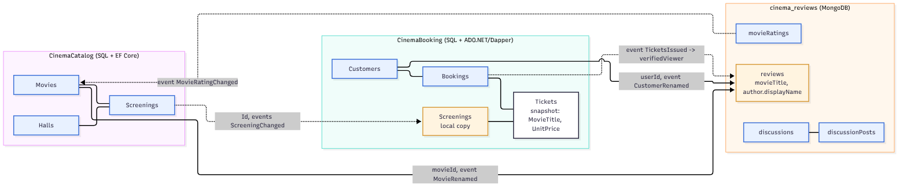
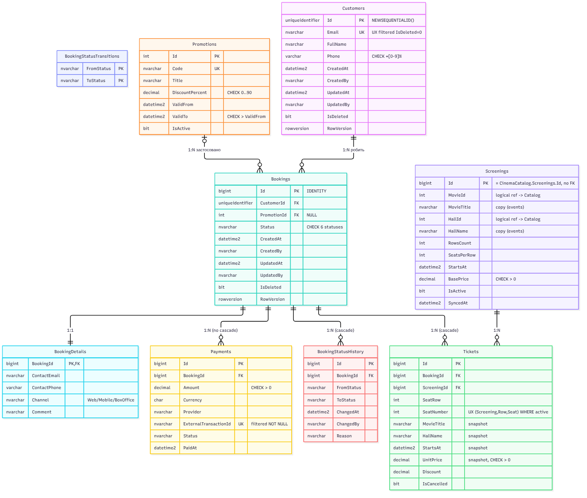
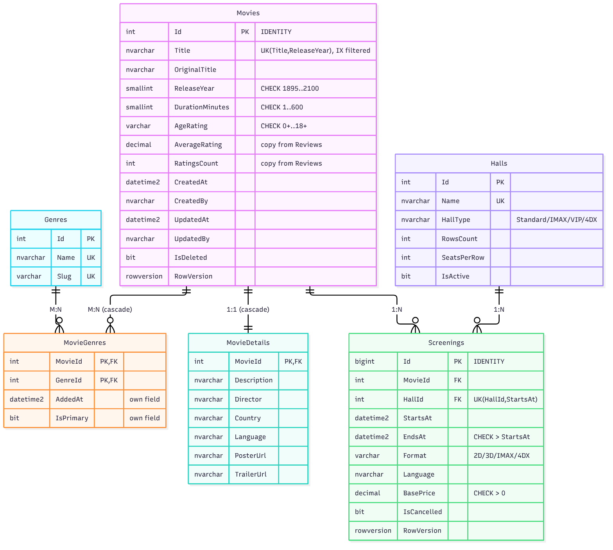

# Лаб. 01 — Бази даних для мікросервісів «Кінотеатр»

Три незалежні бази для трьох майбутніх мікросервісів:

| Проєкт | Сервіс | База | Технологія в наступних лабах |
|---|---|---|---|
| №1 | **Бронювання** квитків | SQL Server `CinemaBooking` | Лаб. 02 — ADO.NET + Dapper |
| №2 | **Каталог** фільмів і розклад | SQL Server `CinemaCatalog` | Лаб. 03 — EF Core (Code First + Fluent API) |
| №3 | **Відгуки** та обговорення | MongoDB `cinema_reviews` | Лаб. 04 — MongoDB Driver |

## 1. Предметна область

Мережевий кінотеатр. **Глядачі** переглядають афішу, бронюють і оплачують місця на сеанси, після перегляду пишуть відгуки та обговорюють фільми. **Контент-менеджери** ведуть каталог фільмів, залів і розклад сеансів. Система потрібна, щоб продавати квитки онлайн без подвійних продажів одного місця і показувати глядачам актуальний розклад і рейтинг фільмів.

### Контексти та сутності

Кожна сутність має рівно одного власника. Інші контексти знають її тільки за Id і, за потреби, зберігають копію окремих полів.

| Контекст (БД) | Власні сутності | Що бере з інших контекстів |
|---|---|---|
| **Бронювання** (`CinemaBooking`) | Customer, Booking, BookingDetails, Ticket, Payment, Promotion, BookingStatusHistory | Screening: локальна копія з Каталогу |
| **Каталог** (`CinemaCatalog`) | Movie, MovieDetails, Genre, MovieGenre, Hall, Screening | AverageRating/RatingsCount: копія з Відгуків |
| **Відгуки** (`cinema_reviews`) | Review (+ вбудовані Comment), Discussion, DiscussionPost, MovieRating | movieTitle (з Каталогу), author.displayName (з Бронювання) |

### Агрегати

| Агрегат | Корінь | Що входить | Чому разом |
|---|---|---|---|
| Бронювання | `Bookings` | BookingDetails, Tickets, BookingStatusHistory | квитки й деталі не існують без бронювання, статус змінюється лише через корінь (як `Order` в eShop) |
| Оплата | `Payments` | — | фінансовий запис: не видаляється каскадом, ідемпотентний за `ExternalTransactionId` |
| Фільм | `Movies` | MovieDetails, MovieGenres | картка фільму редагується цілком |
| Сеанс | `Screenings` | — | окремий агрегат: має власний життєвий цикл (планується, скасовується) |
| Відгук | `reviews` | comments (вбудовані, ≤ 50) | коментарі завжди показуються разом із відгуком |
| Обговорення | `discussions` | lastPosts (копія 3 останніх) | пости живуть окремо (`discussionPosts`), бо їх необмежено багато |

Діаграма контекстів (пунктир — логічне посилання за Id без FOREIGN KEY, подія оновлює копію):



## 2. Політика дублювання даних

| Поле | Де зберігається | Власник даних | Політика узгодженості |
|---|---|---|---|
| `Tickets.MovieTitle`, `HallName`, `StartsAt`, `UnitPrice` | CinemaBooking | Каталог (Movies, Halls, Screenings) | **Знімок** на момент бронювання. Не оновлюється (як `OrderItem.ProductName/UnitPrice` в eShop) |
| `Screenings.*` (MovieId, MovieTitle, HallId, HallName, RowsCount, SeatsPerRow, StartsAt, BasePrice, IsActive) | CinemaBooking (локальний довідник) | Каталог (Screenings, Movies, Halls) | **Копія**, оновлюється подіями `ScreeningScheduled`, `ScreeningChanged`, `ScreeningCancelled`, `MovieRenamed` (Лаб. 08) |
| `reviews.movieTitle`, `discussions.movieTitle`, `movieRatings.movieTitle` | cinema_reviews | Каталог (Movies.Title) | **Копія**, оновлюється подією `MovieRenamed` (`updateMany({movieId})`, приклад у `03_queries.js`, крок 9) |
| `author.displayName` у reviews / comments / discussions / discussionPosts | cinema_reviews | Бронювання (Customers.FullName) | **Копія**, оновлюється подією `CustomerRenamed`. `author.userId` — незмінний ідентифікатор |
| `reviews.verifiedViewer`, `reviews.bookingId` | cinema_reviews | Бронювання (Bookings.Status = Issued) | Ставиться подією `TicketsIssued`. Це **знімок** факту перегляду, тож потім не змінюється |
| `Movies.AverageRating`, `Movies.RatingsCount` | CinemaCatalog | Відгуки (movieRatings) | **Копія**, оновлюється подією `MovieRatingChanged` |
| `discussions.lastPosts` | cinema_reviews | Відгуки (discussionPosts) | Дублювання **всередині** сервісу: оновлюється в тій самій операції, що й додавання поста (`$push` + `$slice: -3`) |
| `BookingDetails.ContactEmail` | CinemaBooking | Бронювання (Customers.Email) | Дублювання **всередині** сервісу: знімок контакту на момент бронювання |

Подвійного запису (dual write) немає: кожне поле редагується лише у власника, всі інші копії тільки читають його або отримують через події.

## 3. Розгортання з нуля

### Що потрібно
* **Docker Desktop** (Windows), запущений.
* Для перегляду баз (необов'язково): **DataGrip** або **Rider** (вкладка *Database*).

### Варіант А — одним скриптом (рекомендовано)

```powershell
cd <папка-лаби>
.\deploy.ps1 -Tests
```
Якщо PowerShell блокує запуск скриптів: `powershell -ExecutionPolicy Bypass -File .\deploy.ps1 -Tests`.
Можна просто двічі клацнути по **`run-deploy-tests.cmd`**: він робить те саме, а повний вивід записує в `deploy.log`.

Скрипт виконує:
1. `docker compose up -d`: піднімає SQL Server 2022 (`cinema-mssql`, порт 1433) і MongoDB 7 (`cinema-mongo`, порт 27017) та чекає, доки обидва стануть healthy.
2. `sql/00_init.sql`: створює бази `CinemaBooking`, `CinemaCatalog` і окремі логіни застосунків.
3. **Проєкт №1:** `booking/01_schema.sql` → `02_procedures.sql` → `03_seed.sql`.
4. **Проєкт №2:** `catalog/01_schema.sql` → `02_seed.sql`.
5. **Проєкт №3:** `mongo/01_schema.js` → `02_seed.js` → `migrations/001_reviews_add_locale.js`.
6. З прапорцем `-Tests` ще запускає `booking/04_tests.sql`, `catalog/03_tests.sql` і `mongo/03_queries.js`. Рядки `OK:` у виводі означають, що перевірка пройшла, `FAIL:` — що ні.

`.\deploy.ps1 -Reset` видаляє контейнери разом з даними й розгортає все заново. Повторний запуск без `-Reset` безпечний: усі скрипти ідемпотентні.

### Варіант Б — вручну (DataGrip / Rider)

1. `docker compose up -d`
2. Підключення SQL Server: host `localhost`, port `1433`, user `sa`, password `Cinema_Sa#2026`.
3. Відкрийте й виконайте скрипти (*Run* / `Ctrl+Enter` → *Execute all*) у такому порядку:
   `sql/00_init.sql` → `sql/booking/01_schema.sql` → `02_procedures.sql` → `03_seed.sql` → `sql/catalog/01_schema.sql` → `02_seed.sql`.
4. Підключення MongoDB: `mongodb://localhost:27017`. Виконайте `mongo/01_schema.js` → `02_seed.js`.
   Або з терміналу: `docker exec cinema-mongo mongosh /scripts/mongo/01_schema.js`.
5. ERD у DataGrip: правий клік по базі → *Diagrams → Show Diagram*.

### Облікові дані (лише для локальної розробки)

| Що | Логін | Пароль | Доступ |
|---|---|---|---|
| Адміністратор SQL | `sa` | `Cinema_Sa#2026` | усе |
| Сервіс Бронювання | `cinema_booking_app` | `Booking_App#2026` | лише `CinemaBooking`: читання, запис, EXECUTE |
| Сервіс Каталогу | `cinema_catalog_app` | `Catalog_App#2026` | лише `CinemaCatalog`: читання, запис, DDL для міграцій EF |
| MongoDB | — | — | без автентифікації (локально) |

Рядки підключення для наступних лаб:
```
Server=localhost,1433;Database=CinemaBooking;User Id=cinema_booking_app;Password=Booking_App#2026;TrustServerCertificate=True
Server=localhost,1433;Database=CinemaCatalog;User Id=cinema_catalog_app;Password=Catalog_App#2026;TrustServerCertificate=True
mongodb://localhost:27017/cinema_reviews
```

## 4. Проєкт №1 — CinemaBooking (SQL Server + ADO.NET/Dapper)

### ERD Проєкту №1



Вихідний код діаграми: [`docs/erd/booking.mmd`](docs/erd/booking.mmd) (Mermaid).

**Таблиці (9):** Customers, Promotions, Screenings (локальна копія), Bookings, BookingDetails, Tickets, BookingStatusHistory, BookingStatusTransitions, Payments. Плюс представлення `vw_BookingSummary`.

| Зв'язок | Де | Де розташований FK |
|---|---|---|
| **1:1** | Bookings ↔ BookingDetails | `BookingDetails.BookingId`: водночас PK і FK |
| **1:N** | Customers → Bookings, Bookings → Payments / History, Promotions → Bookings | FK на боці «багатьох» |
| **M:N** | Bookings ↔ Screenings через **Tickets** | Tickets має два FK і власні поля: місце, ціна, знижка, IsCancelled |

**Вибір PK:**
* `Customers.Id`: **GUID** (`NEWSEQUENTIALID()`). Це публічний ідентифікатор, на який посилаються інші сервіси (`author.userId` у MongoDB), і його можна згенерувати поза БД. Послідовний GUID зменшує фрагментацію.
* `Bookings`, `Tickets`, `Payments`, `History`: **BIGINT IDENTITY**. Записи створює лише цей сервіс, вставка послідовна, а 8-байтовий ключ компактний для FK.
* `Screenings.Id`: **BIGINT без IDENTITY**, бо береться з Каталогу.

**Каскади:**
* `ON DELETE CASCADE` стоїть на BookingDetails, Tickets і History, бо це частини агрегату.
* Payments і Customers видаляються **без каскаду**: фінансові записи й клієнт з історією захищені. Для клієнта є soft delete (`IsDeleted`).

**Аудит і конкурентність:**
* У Customers і Bookings є `CreatedAt/By`, `UpdatedAt/By`, `IsDeleted` і `RowVersion` (`rowversion`). Статус бронювання одночасно можуть змінювати касир, платіжний шлюз і фонова задача.
* `usp_Booking_ChangeStatus` і `usp_Customer_Upsert` приймають `@ExpectedRowVersion`. Якщо запис уже змінив хтось інший, процедура видає помилку, а не тихо його перезаписує.

### Статуси (за зразком `OrderStatus` з eShop)

```
Submitted → AwaitingValidation → SeatsConfirmed → Paid → Issued
    └──────────────┴──────────────────┴──→ Cancelled   (лише ДО оплати)
```
Допустимі переходи записані в таблиці `BookingStatusTransitions`.

### Збережувані процедури (6)

| Процедура | Тип | Що робить |
|---|---|---|
| `usp_Customer_Upsert` | Create/Update/soft-Delete | створює або оновлює клієнта; перевіряє унікальність email і `RowVersion` |
| `usp_Booking_Create` | Create, транзакція | приймає місця як JSON. Блокує їх (`UPDLOCK, HOLDLOCK`), створює Booking, Details і Tickets зі **знімком** ціни та назви, застосовує промокод |
| `usp_Booking_GetById` | Read | повертає 3 набори результатів: бронювання, квитки, історію (для `QueryMultiple` у Dapper) |
| `usp_Bookings_GetByCustomer` | Read, пошук | фільтр за статусом, пагінація `OFFSET/FETCH`, `TotalCount` |
| **`usp_Booking_ChangeStatus`** | бізнес-операція | явна транзакція + `XACT_ABORT`; `UPDLOCK` на рядку; перевірка переходу. На недопустимому переході `THROW 50002`, і дані **не змінюються** |
| `usp_Payment_Register` | бізнес-операція | в одній транзакції записує оплату й переводить бронювання в `Paid` (вкладений виклик ChangeStatus). Ідемпотентна за `ExternalTransactionId` |

### Коди керованих помилок

| Код | Причина |
|---|---|
| 50001 | бронювання не знайдено |
| 50002 | **недопустимий перехід статусу** (напр. `Submitted -> Issued` або скасування після оплати) |
| 50003 | конфлікт конкурентності (RowVersion) |
| 50004 | спроба перейти в `Paid` без достатньої оплати |
| 50010–50015 | некоректні місця, клієнт не знайдений, сеанс скасовано, місце поза залою, недійсний промокод, місце зайняте |
| 50020, 50021 | оплата не в статусі `SeatsConfirmed`, сума не збігається |
| 50030–50032 | клієнта не знайдено, дубль email, конфлікт версій |
| 50040 | некоректні параметри пагінації |

**Перевірка головного критерію** (є в `04_tests.sql`, розділ 4):
```sql
EXEC dbo.usp_Booking_ChangeStatus @BookingId = 3, @NewStatus = N'Issued';
-- Msg 50002: Недопустимий перехід статусу: Submitted -> Issued (бронювання #3)
SELECT Status FROM dbo.Bookings WHERE Id = 3;   -- лишився Submitted
```

### Індекси Проєкту №1

| Індекс | Під який запит |
|---|---|
| `UX_Customers_Email_Active` (Email) WHERE IsDeleted = 0 | пошук клієнта за email; email унікальний серед активних |
| `IX_Bookings_CustomerId_Status` (CustomerId, Status) INCLUDE(...) | «бронювання клієнта з певним статусом» |
| `IX_Bookings_CustomerId_CreatedAt` (CustomerId, CreatedAt DESC) INCLUDE(...) | історія клієнта, нові зверху, з пагінацією (покриваючий) |
| `IX_Bookings_Pending_CreatedAt` WHERE Status IN (незавершені) | фонова задача: «скасувати неоплачені старші за 15 хв» (фільтрований) |
| `UX_Tickets_Screening_Seat_Active` (ScreeningId, SeatRow, SeatNumber) WHERE IsCancelled = 0 | «чи вільне місце» + гарантія «одне місце = один квиток» |
| `IX_Tickets_BookingId` INCLUDE(UnitPrice, Discount, ...) | квитки бронювання й сума до сплати (vw_BookingSummary) |
| `IX_BookingStatusHistory_BookingId_ChangedAt` | журнал статусів у хронологічному порядку |
| `IX_Payments_BookingId` INCLUDE(Amount, Status) | сума оплат перед переходом у Paid |
| `UX_Payments_ExternalTransactionId` WHERE NOT NULL | ідемпотентність повторних колбеків платіжного шлюзу |
| `IX_Screenings_MovieId` | обробник `MovieRenamed`: оновити назву в усіх сеансах фільму |

## 5. Проєкт №2 — CinemaCatalog (SQL Server, далі EF Core)

### ERD Проєкту №2



Вихідний код діаграми: [`docs/erd/catalog.mmd`](docs/erd/catalog.mmd) (Mermaid).

**6 сутностей:** Movies, MovieDetails, Genres, MovieGenres, Halls, Screenings. Плюс представлення `vw_Schedule`.

| Зв'язок | Де |
|---|---|
| **1:1** | Movies ↔ MovieDetails («важкі» поля винесено окремо, PK = FK, cascade) |
| **1:N** | Movies → Screenings, Halls → Screenings (без каскаду) |
| **M:N** | Movies ↔ Genres через **MovieGenres** з власними полями `AddedAt` і `IsPrimary` |

**PK:**
* `INT IDENTITY` для Movies, Genres і Halls: це невеликі довідники з одним джерелом вставки.
* `BIGINT IDENTITY` для Screenings: таблиця росте щодня, а її Id передається в CinemaBooking.

**Обмеження:**
* UNIQUE: `Genres.Name`, `Genres.Slug`, `Halls.Name`, `(Movies.Title, ReleaseYear)`, `(Screenings.HallId, StartsAt)`.
* CHECK: ціна > 0, `EndsAt > StartsAt`, рік 1895–2100, тривалість, віковий рейтинг, формат, тип зали, slug.

**Готовність до міграцій:** у Лаб. 03 ця схема відтворюється через Fluent API (`IEntityTypeConfiguration<T>`), а seed-дані з `02_seed.sql` переїжджають у `HasData()`. Після цього схема змінюється тільки командами `dotnet ef migrations add` / `database update`. Логін `cinema_catalog_app` має `db_ddladmin`, тому може застосовувати міграції.

| Індекс | Під який запит |
|---|---|
| `IX_Movies_Title_Active` (Title) WHERE IsDeleted = 0 INCLUDE(...) | пошук фільму за назвою `LIKE N'Дюна%'` |
| `IX_MovieGenres_GenreId` (GenreId, MovieId) | «фільми жанру X» (PK починається з MovieId, тому потрібен зворотний індекс) |
| `IX_Screenings_StartsAt_Active` (StartsAt) WHERE IsCancelled = 0 | «розклад на день» |
| `IX_Screenings_MovieId_StartsAt` | «найближчі сеанси фільму» |
| `UQ_Screenings_Hall_StartsAt` | два сеанси в одній залі одночасно неможливі |
| `UQ_Genres_Slug` | пошук жанру за slug з URL |

**Seed-дані:** 7 жанрів, 3 зали, 5 фільмів із деталями, 14 зв'язків фільм–жанр, 8 сеансів.

## 6. Проєкт №3 — MongoDB `cinema_reviews`

| Колекція | Прийом моделювання | Пояснення |
|---|---|---|
| `reviews` | **embedding** | коментарі (≤ 50, `$push` + `$slice`) вбудовані: їх завжди показують разом із відгуком. `author` — вбудований об'єкт |
| `discussions` | **гібрид** | вбудовані 3 останні пости (`lastPosts`) для швидкого списку тем + посилання на повний список у `discussionPosts` |
| `discussionPosts` | **referencing** | `discussionId` → discussions. Постів необмежено багато, тому вбудовувати їх не можна (ліміт 16 МБ) |
| `movieRatings` | денормалізація для читання | `_id = movieId`, рахується aggregation pipeline з `$merge` |

`reviews.discussionId` — ще одне посилання (reference) між колекціями.

**Гнучка схема** (`db.reviews.find()` повертає документи з різними наборами полів):
* повний відгук має `aspects`, `photos`, `comments`, `verifiedViewer`, `bookingId`;
* у відгуку зі спойлером є поле `spoiler`;
* мінімальний відгук містить лише обов'язкові поля + `tags`;
* в одному відгуку є `pros`/`cons`, у сімейному — вкладений `watchedWith: { type, kidsAges: [] }`;
* серед тем є тема-опитування з полем `poll.options[]` і закрита тема з полями `closedAt`/`closedReason`.

**JSON Schema Validation:**
* для всіх 4 колекцій;
* обов'язкові поля, `rating` — `int` від 1 до 5, `status` — enum, `lastPosts` ≤ 3, `comments` ≤ 50;
* у `03_queries.js` вставка з `rating: 7` і вставка без `author` відхиляються.

**Індекси:** `{movieId, createdAt:-1}` (відгуки фільму з пагінацією), унікальний `{author.userId, movieId}` (один відгук на фільм), текстовий `{text}`, `{movieId, lastActivityAt:-1}`, `{discussionId, createdAt}`, `{average:-1, count:-1}`.

**Aggregation pipeline:**
* рейтинг і розподіл оцінок → `movieRatings` (`$group` + `$merge`);
* середні оцінки за аспектами (`$objectToArray` + `$unwind`);
* найактивніші автори (`$unionWith`);
* `$lookup` reviews → discussions.

**Приклади документів у JSON** (Extended JSON, ті самі дані, що й у `02_seed.js`): [`mongo/examples/`](mongo/examples/): `reviews.json`, `discussions.json`, `discussionPosts.json`, `movieRatings.json`.

Скорочений приклад відгуку, що поєднує всі прийоми:

```json
{
  "_id": { "$oid": "000000000000000000000301" },
  "movieId": 3,                                   // посилання на Каталог (без FK)
  "movieTitle": "Дюна: Частина друга",            // денормалізовано (політика дублювання)
  "author": { "userId": "6f1c2a10-…-000000000001", "displayName": "Олена Коваленко" },
  "rating": 5,
  "aspects": { "story": 5, "visuals": 5 },      // вкладений об'єкт, є лише в частини документів
  "photos": ["reviews/301/hall.jpg"],            // поле є лише в частини документів
  "comments": [                                    // EMBEDDING: вбудований масив
    { "author": { "displayName": "Андрій Шевчук" }, "text": "Згоден, IMAX того вартий!" }
  ],
  "discussionId": { "$oid": "000000000000000000000101" }   // REFERENCING на discussions
}
```

**Версіонування:** `mongo/migrations/001_*.js` — міграція з журналом у колекції `_migrations` (як changelog у Mongock).

## 7. Відповідність критеріям перевірки

| Критерій | Де це в репозиторії |
|---|---|
| **Описано предметну область і три незалежні контексти з їхніми сутностями** | розділ 1: опис домену, таблиця контекстів (кожна сутність має одного власника), агрегати |
| **Таблиця політики дублювання даних між базами** | розділ 2: для кожного поля вказано, де воно зберігається, хто власник і чи це знімок, чи копія, яку оновлюють події |
| **Три самостійні бази без FOREIGN KEY між ними** | `00_init.sql` створює окремі БД; `Screenings.Id/MovieId/HallId` у Booking і `movieId`/`userId` у Mongo — звичайні поля. Перевірка: `SELECT * FROM sys.foreign_keys` (розділ 1 у `booking/04_tests.sql` і `catalog/03_tests.sql`) |
| **Проєкт №1: щонайменше 4 таблиці зі зв'язками 1:1, 1:N і M:N** | `booking/01_schema.sql`: 9 таблиць. 1:1 — `BookingDetails.BookingId` (PK = FK). 1:N — `Bookings.CustomerId`. M:N — `Tickets` (два FK). ERD у розділі 4 |
| **Ключі, обмеження й індекси під конкретні запити** | PK/FK/UNIQUE/CHECK/DEFAULT у DDL. Каскади пояснено в коментарях (cascade для частин агрегату, NO ACTION для Payments/Customers). Біля кожного індексу коментар, під який запит він створений; таблиці індексів у розділах 4 і 5 |
| **Аудитні колонки, м'яке видалення та оптимістична конкурентність** | `CreatedAt/CreatedBy/UpdatedAt/UpdatedBy/IsDeleted` + `RowVersion ROWVERSION` у `Customers`, `Bookings`, `Movies`; `RowVersion` у `Screenings` (Catalog). `@ExpectedRowVersion` у процедурах |
| **4–6 збережуваних процедур, зокрема транзакційна зміна статусу** | `booking/02_procedures.sql`: 6 процедур. `usp_Booking_ChangeStatus`: явна транзакція, `UPDLOCK`, `THROW 50002` на недопустимому переході. Перевірка в розділі 4 `04_tests.sql` |
| **Проєкт №2: 4–6 сутностей, усі типи зв'язків і M:N з власним полем** | `catalog/01_schema.sql`: 6 сутностей. 1:1 `MovieDetails`, 1:N `Screenings`, M:N `MovieGenres` (`AddedAt`, `IsPrimary`). UNIQUE, індекси, CHECK, довідникові seed-дані в `catalog/02_seed.sql` |
| **MongoDB: 3–4 колекції з embedding, referencing і гібридним підходом** | `mongo/01_schema.js` (4 колекції + JSON Schema + індекси), `mongo/02_seed.js`, приклади в `mongo/examples/*.json`. Embedding — `reviews.comments`. Referencing — `discussionPosts.discussionId`. Гібрид — `discussions.lastPosts`. Денормалізоване поле — `movieTitle`. Різні набори полів — `03_queries.js`, розділ 1 |
| **Ідемпотентні seed-скрипти для всіх баз** | SQL: `MERGE ... WHEN NOT MATCHED` та `IF NOT EXISTS`. Mongo: `updateOne({_id}, {$setOnInsert}, {upsert: true})`. Повторний запуск `deploy.ps1` додає 0 рядків і 0 документів |
| **Скрипти розгортання та README з порядком запуску й ERD** | окремі файли `01_schema.sql` → `02_procedures.sql` → `03_seed.sql`, Mongo-скрипти, `docker-compose.yml` + `deploy.ps1`; порядок — розділ 3; ERD — розділи 4 і 5 |

## 8. Структура

```
docker-compose.yml        SQL Server 2022 + MongoDB 7
deploy.ps1                розгортання з нуля (-Tests, -Reset)
run-deploy-tests.cmd      те саме подвійним кліком, вивід у deploy.log
sql/00_init.sql           бази + логіни з мінімальними правами
sql/booking/              Проєкт №1: 01_schema, 02_procedures, 03_seed, 04_tests
sql/catalog/              Проєкт №2: 01_schema, 02_seed, 03_tests
mongo/                    Проєкт №3: 01_schema (колекції + валідація + індекси), 02_seed, 03_queries, migrations/
mongo/examples/           приклади документів у JSON
docs/erd/                 ERD (PNG + вихідні Mermaid .mmd)
docs/control-questions.md відповіді на контрольні питання
```
