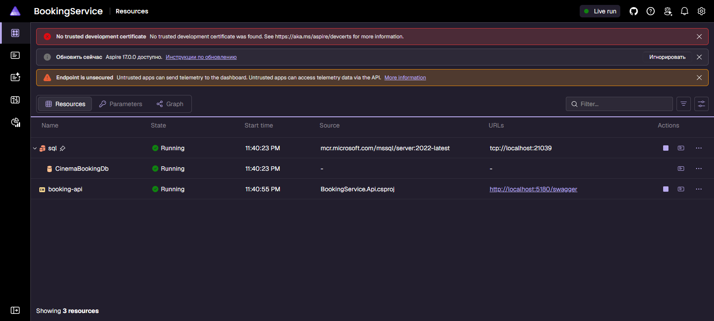
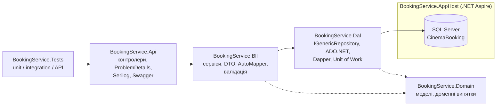
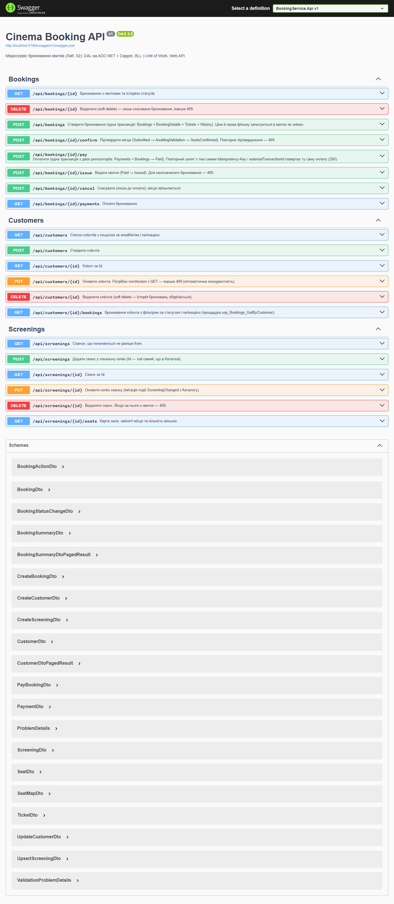

# Лаб. 02 — Тришарова архітектура на ADO.NET та Dapper

Мікросервіс **бронювання квитків** кінотеатру — самостійна вертикаль від бази до API на базі **Проєкту №1 з Лаб. 01** (`CinemaBooking`):

**DAL** (ADO.NET + Dapper, Unit of Work) → **BLL** (сервіси, DTO, AutoMapper, доменні винятки) → **Web/API** (контролери, ProblemDetails, Swagger), запуск разом із базою через **.NET Aspire**.

| Що | Як реалізовано |
|---|---|
| CRUD | клієнти, сеанси (локальна копія Каталогу), бронювання, оплати |
| Транзакційні операції | створення бронювання (4 таблиці), підтвердження (2 переходи статусу), оплата (2 репозиторії) — усе через Unit of Work |
| SQL лише в DAL | контролери й сервіси не містять жодного SQL-запиту |
| Помилки | 400 / 404 / 409 у форматі ProblemDetails (RFC 9457) з `traceId` |
| Запуск | `dotnet run --project src/BookingService.AppHost` — SQL Server у контейнері + API |

---

## 1. Що потрібно для запуску

* **.NET 10 SDK** (для AppHost на Aspire 13; сам сервіс — `net9.0`, тож потрібен і runtime .NET 9). Перевірка: `dotnet --list-sdks`.
* **Docker Desktop**, запущений (Aspire піднімає SQL Server у контейнері).
* IDE: Rider / Visual Studio / VS Code — необов'язково.

## 2. Запуск через .NET Aspire (одна команда)

```bash
cd Lab02-BookingService
dotnet run --project src/BookingService.AppHost
```

Або в Rider/VS зробіть стартовим проєктом **BookingService.AppHost** і натисніть Run.

Що відбувається:
1. Aspire піднімає контейнер **SQL Server** (`sql`) і створює в ньому базу **CinemaBooking** (ресурс `CinemaBookingDb`).
2. Коли база готова (`WaitFor`), стартує **booking-api**. Порожня база автоматично наповнюється скриптами з Лаб. 01: `db/01_schema.sql` → `02_procedures.sql` → `03_seed.sql`. Скрипти ідемпотентні.
3. Aspire передає в API рядок підключення через `ConnectionStrings__CinemaBookingDb`. Ім'я ресурсу збігається з ім'ям рядка підключення, тому код API змінювати не потрібно.

**Aspire Dashboard:** http://localhost:15180. Там видно стан ресурсів, логи й посилання на API.
**Swagger:** http://localhost:5180/swagger (посилання є й у Dashboard).



### Варіант: наявна база з Лаб. 01

Якщо працює контейнер `cinema-mssql` з Лаб. 01, у `src/BookingService.AppHost/appsettings.json` поставте `"UseExistingDatabase": true`. Тоді Aspire передасть API рядок підключення до неї (логін `cinema_booking_app` — лише свою базу, найменші привілеї).

### Без Aspire

```bash
dotnet run --project src/BookingService.Api      # рядок підключення — з appsettings.json
```

Перевизначення змінною оточення (подвійне підкреслення замість двокрапки):

```powershell
$env:ConnectionStrings__CinemaBookingDb = "Server=localhost,1433;Database=CinemaBooking;User Id=cinema_booking_app;Password=Booking_App#2026;TrustServerCertificate=True"
```

## 3. Схема рішення



| Проєкт | Призначення |
|---|---|
| `src/BookingService.Domain` | моделі за таблицями Лаб. 01, константи статусів, доменні винятки (`NotFoundException`, `BusinessConflictException`, `ValidationException`) |
| `src/BookingService.Dal` | `IGenericRepository<T>`, інтерфейси репозиторіїв, реалізації ADO.NET і Dapper, `UnitOfWork`, перетворення `SqlException` → доменні винятки, bootstrapper бази |
| `src/BookingService.Bll` | DTO (з DataAnnotations), профілі AutoMapper, сервіси `ICustomerService`, `IScreeningService`, `IBookingService` |
| `src/BookingService.Api` | контролери з атрибутною маршрутизацією, `DomainExceptionHandler`, `CorrelationIdMiddleware`, Serilog, Swagger |
| `src/BookingService.AppHost` | Aspire: SQL Server-контейнер + API |
| `tests/BookingService.Tests` | unit-тести BLL (Moq), тест AutoMapper, інтеграційні тести DAL/UoW, API-тести (WebApplicationFactory) |
| `db/` | скрипти бази Проєкту №1 з Лаб. 01 (вбудовані в DAL) |

**Залежності — в один бік:** Api → Bll → Dal; Domain підключають Dal і Bll. Контролери отримують лише сервіси BLL і ніколи не звертаються до репозиторіїв. API реєструє все одним викликом `AddBusinessLogicLayer(...)`.

## 4. DAL — репозиторії та Unit of Work

| Репозиторій | Технологія | Що показує |
|---|---|---|
| `CustomerRepository` | **чистий ADO.NET** (`SqlCommand`, `SqlParameter`, `SqlDataReader`) | ручне читання й мапінг; виклик `usp_Customer_Upsert` з `CommandType.StoredProcedure` та OUTPUT-параметром; `UPDATE ... OUTPUT INSERTED.RowVersion` з перевіркою версії. **Свідомо НЕ успадковує** Generic Repository: ключ — GUID, а мета — показати «ручну» роботу |
| `BookingRepository` | **Dapper** : `BaseDapperRepository<Booking>` | **multi-mapping**: бронювання + деталі + квитки одним запитом (`splitOn: "BookingId,Id"`); процедури `usp_Booking_ChangeStatus` і `usp_Bookings_GetByCustomer`; soft delete |
| `ScreeningRepository` | **Dapper** | локальна копія сеансів Каталогу (Id не IDENTITY) |
| `PaymentRepository` | **Dapper** | пошук за ключем ідемпотентності |
| `PromotionRepository` | **Dapper** | пошук чинного промокоду |

* **`BaseDapperRepository<T>`** — спільний CRUD (`GetByIdAsync`, `GetAllAsync`, `AddAsync`, `DeleteAsync`), написаний **один раз**. Нащадки задають лише ім'я таблиці (константу з коду, а не вхідні дані), SQL вставки й свої запити.
* **Параметризація:** усі значення йдуть лише параметрами (`@Id`, анонімні об'єкти Dapper, `SqlParameter`). Конкатенації вхідних даних у SQL немає, тож ім'я `O'Brien` нічого не ламає (є тест). Пошук `LIKE` екранує `%`, `_`, `[`.
* **З'єднання:** `await using` / пул підключень SqlClient. Dapper сам не відкриває й не закриває з'єднання — ним керує Unit of Work.

### Unit of Work, транзакції, ізоляція

`UnitOfWork` реєструється як **Scoped**: на один HTTP-запит — одне з'єднання. Усі репозиторії отримують **те саме** з'єднання і делегат `() => _transaction`, тож бачать поточну транзакцію. `BeginTransactionAsync` / `CommitAsync` / `RollbackAsync` гарантують, що виконається або все, або нічого.

| Сценарій у транзакції | Таблиці / репозиторії |
|---|---|
| `POST /api/bookings` — створення | `Bookings` + `BookingDetails` + `Tickets` + `BookingStatusHistory`. Назва фільму, зала й ціна беруться з `Screenings` і записуються в квиток як **знімок** (політика дублювання Лаб. 01) |
| `POST /api/bookings/{id}/confirm` | два переходи статусу (`Submitted → AwaitingValidation → SeatsConfirmed`) через процедуру |
| `POST /api/bookings/{id}/pay` | **2 репозиторії:** `Payments` (вставка) + `Bookings` (процедура → `Paid`). Якщо процедура відмовить (`THROW 50002`), вставка оплати теж відкочується |

**Рівень ізоляції: `ReadCommitted`** (за замовчуванням).
* Він не допускає «брудних» читань, а блокування за нього короткі, тож ризик deadlock мінімальний.
* Від гонки за одне місце захищає не вищий рівень ізоляції, а унікальний фільтрований індекс `UX_Tickets_Screening_Seat_Active`: друге бронювання того самого місця отримує помилку 2601, і сервіс повертає 409 з повним відкатом.
* Від паралельної зміни статусу захищає `UPDLOCK` у процедурі.
* **Компроміс:** `RepeatableRead` / `Serializable` дали б менше аномалій читання, але більше блокувань і взаємних блокувань під навантаженням.

**Таймаути:** `Database:CommandTimeoutSeconds` (30 с) для кожної команди та `Connect Timeout` у рядку підключення. `CancellationToken` іде від контролера до DAL, тож скасований HTTP-запит перериває й запит до SQL Server.

**Конкурентність:**
* **Optimistic** (`rowversion`) — редагування клієнта: `PUT /api/customers/{id}` з `rowVersion` з GET; застаріла версія дає 409.
* **Pessimistic** (`UPDLOCK`) — зміна статусу бронювання, бо її одночасно ініціюють касир, платіжний шлюз і фонові задачі.
* **Ідемпотентність оплати:** заголовок `Idempotency-Key` (або `externalTransactionId`). Повтор того самого запиту повертає ту саму оплату (200), а не створює другу.

### Помилки: процедура → DAL → BLL → HTTP

`SqlErrorTranslator` перетворює `SqlException` на доменні винятки. Сирий текст SQL в API не потрапляє.

| Джерело | Доменний виняток | HTTP |
|---|---|---|
| `THROW 50001, 50011, 50012, 50030` | `NotFoundException` | 404 |
| `THROW 50002` (недопустимий перехід), `50003`, `50004`, `50015`, `50020`, `50021`, `50031`, `50032`; UNIQUE `2601/2627`; FK `547` | `BusinessConflictException` | 409 |
| `THROW 50010, 50013, 50014, 50040`; бізнес-валідація в сервісах | `ValidationException` | 400 |
| DataAnnotations на DTO (ще до виклику сервісу) | — | 400 `ValidationProblemDetails` |

Статуси формує **один** глобальний `DomainExceptionHandler` (`IExceptionHandler` + `AddProblemDetails`), а не try/catch у кожній дії. Кожна помилка містить `traceId` і `correlationId`. Для 500 текст винятку клієнту не віддається.

**Логування:** Serilog. Кожен запис містить `CorrelationId` із заголовка `X-Correlation-ID` (або згенерований), який повертається у відповіді. Тіла запитів у лог не пишуться, тож секретів там немає.

## 5. BLL

* **DTO** — окремі для входу й виходу (`CreateBookingDto`, `BookingDto`, `PayBookingDto`, …), лише дані.
* **AutoMapper** (Community-ліцензія; ключ задається в `AutoMapper:LicenseKey`, без нього в лог пишеться попередження). Профілі зареєстровано централізовано в `MappingConfiguration`; цей самий набір перевіряє тест `AssertConfigurationIsValid`.
* **Два рівні валідації:**
  1. **DataAnnotations** на DTO: формат email і телефону, діапазони, кількість місць. Невалідний запит отримує 400 ще до виклику сервісу.
  2. **Бізнес-валідація** в сервісах: правила, яким потрібен стан БД — чи існує клієнт, чи місце в межах зали і вільне, чи діє промокод, чи збігається сума оплати. Складні правила винесено в окремий `SeatSelectionValidator`.

## 6. API — ендпоінти



| Метод | Маршрут | Успіх | Помилки |
|---|---|---|---|
| GET | `/api/customers?search=&page=&pageSize=` | 200 | 400 |
| GET | `/api/customers/{id:guid}` | 200 | 404 |
| POST | `/api/customers` | **201** + Location | 400, 409 |
| PUT | `/api/customers/{id:guid}` | 200 | 400, 404, 409 |
| DELETE | `/api/customers/{id:guid}` | **204** | 404 |
| GET | `/api/customers/{id:guid}/bookings?status=&page=` | 200 | 400, 404 |
| GET | `/api/screenings`, `/api/screenings/{id:long}`, `/{id}/seats` | 200 | 404 |
| POST / PUT / DELETE | `/api/screenings[/{id:long}]` | 201 / 200 / 204 | 400, 404, 409 |
| GET | `/api/bookings/{id:long}` | 200 | 404 |
| POST | `/api/bookings` | **201** + Location | 400, 409 |
| POST | `/api/bookings/{id}/confirm` | **204** | 404, **409** (повторне підтвердження) |
| POST | `/api/bookings/{id}/pay` (+ `Idempotency-Key`) | 201 / 200 (повтор) | 400, 404, 409 |
| POST | `/api/bookings/{id}/issue`, `/cancel` | 204 | 404, 409 |
| GET | `/api/bookings/{id}/payments` | 200 | 404 |
| DELETE | `/api/bookings/{id}` | 204 | 404, 409 |

### Приклади curl

Повний набір запитів для Rider / VS Code лежить у файлі [`src/BookingService.Api/BookingService.Api.http`](src/BookingService.Api/BookingService.Api.http).

```bash
API=http://localhost:5180

# сеанси та карта зали
curl $API/api/screenings
curl $API/api/screenings/7/seats

# клієнт з апострофом в імені → 201 + Location
curl -i -X POST $API/api/customers -H "Content-Type: application/json" \
     -d '{"email":"sean.obrien@example.com","fullName":"Seán O'\''Brien"}'

# бронювання (одна транзакція, ціна — знімок) → 201
curl -i -X POST $API/api/bookings -H "Content-Type: application/json" \
     -d '{"customerId":"6f1c2a10-0000-4000-8000-000000000004","screeningId":7,"seats":[{"row":3,"seat":5},{"row":3,"seat":6}],"promoCode":"STUDENT20"}'

# неіснуючий Id → 404 ProblemDetails
curl -i $API/api/bookings/999999

# оплата НЕпідтвердженого → 409; оплата відкочується разом зі статусом
curl -i -X POST $API/api/bookings/6/pay -H "Content-Type: application/json" -d '{"amount":400.00,"provider":"Card"}'

# підтвердження → 204; повторне → 409
curl -i -X POST $API/api/bookings/6/confirm
curl -i -X POST $API/api/bookings/6/confirm

# оплата з ключем ідемпотентності → 201; повтор → 200 (та сама оплата)
curl -i -X POST $API/api/bookings/6/pay -H "Content-Type: application/json" -H "Idempotency-Key: TX-DEMO-1" -d '{"amount":400.00,"provider":"Card"}'
```

Приклад відповіді 409:

```json
{
  "type": "https://www.rfc-editor.org/rfc/rfc9110#status.409",
  "title": "Конфлікт бізнес-правила",
  "status": 409,
  "detail": "Недопустимий перехід статусу: SeatsConfirmed -> SeatsConfirmed (бронювання #6)",
  "instance": "/api/bookings/6/confirm",
  "traceId": "0HNQ8S572FHO4:00000003",
  "correlationId": "0HNQ8S572FHO4:00000003"
}
```

## 7. Тести

```powershell
# unit-тести (без бази)
dotnet test

# + інтеграційні та API-тести проти бази Лаб. 01 (контейнер cinema-mssql)
$env:CINEMA_TEST_DB = "Server=localhost,1433;Database=CinemaBooking;User Id=cinema_booking_app;Password=Booking_App#2026;TrustServerCertificate=True"
dotnet test
```

Або на Windows просто двічі клацніть **`verify.cmd`**: він запустить контейнер `cinema-mssql`, збере рішення і прожене всі тести, а результат запише у `verify.log`. Зараз проходять **28 із 28** тестів.

| Тест | Що перевіряє |
|---|---|
| `AutoMapper_configuration_is_valid` | `AssertConfigurationIsValid()` |
| `Confirm_nonexistent_booking_throws_NotFound_and_rolls_back` | контрольна точка кроку C |
| `Create_takes_title_and_price_from_screening_as_snapshot_and_commits` | знімок ціни й назви, Commit |
| `Pay_rolls_back_payment_when_status_change_in_second_repository_fails` | відкат (на моках) |
| `Error_in_second_repository_rolls_back_changes_of_the_first` | **реальний відкат у БД:** оплата + недопустимий перехід |
| `Occupied_seat_violates_unique_index_and_whole_booking_is_rolled_back` | 2601 → 409, бронювання з першого кроку теж зникає |
| `Values_with_quotes_do_not_break_sql` | O'Brien |
| `Customer_update_with_stale_rowversion_is_conflict` | optimistic concurrency |
| `Unknown_id_returns_404_problem_details_not_500` | 404 + `application/problem+json` + `traceId` |
| `Confirming_twice_returns_409_problem_details` | 409 на повторне підтвердження |
| `Paying_unconfirmed_booking_returns_409_and_payment_is_rolled_back` | відкат через API |
| `Full_flow_create_confirm_pay_idempotent_issue` | повний сценарій + ідемпотентність |
| `Invalid_dto_returns_400_before_service_is_called` | модельна валідація |

## 8. Перевірка «Перед здачею»

| Перевірка | Результат |
|---|---|
| Значення зі спецсимволом (`O'Brien`) | синтаксичної помилки SQL немає (тест + запит у `.http`) |
| Помилка в другому репозиторії транзакції | зміни першого відкочуються (оплата + недопустимий статус; зайняте місце) |
| Повторне підтвердження | **409** ProblemDetails |
| Неіснуючий Id | **404**, а не 500 |
| `dotnet run --project src/BookingService.AppHost` | у Dashboard `sql`, `CinemaBookingDb`, `booking-api` — **Running** |
| `/swagger` | усі ендпоінти з описами, моделями та статусами |

## 9. Git

* Лаба зроблена в гілці **`lab-02`**, відгалуженій від `main` (за правилами курсу). Вона ж виконує роль інтеграційної гілки (develop) для цієї лаби.
* Кожен крок робився в окремій гілці **`feature/lab02-*`** і зливався в `lab-02` merge-комітом (`--no-ff`), тож в історії видно кожну фічу. Опис змін для Pull Request `lab-02 → main` — у [`docs/PULL_REQUEST.md`](docs/PULL_REQUEST.md).
* `main` лишається стабільною.
