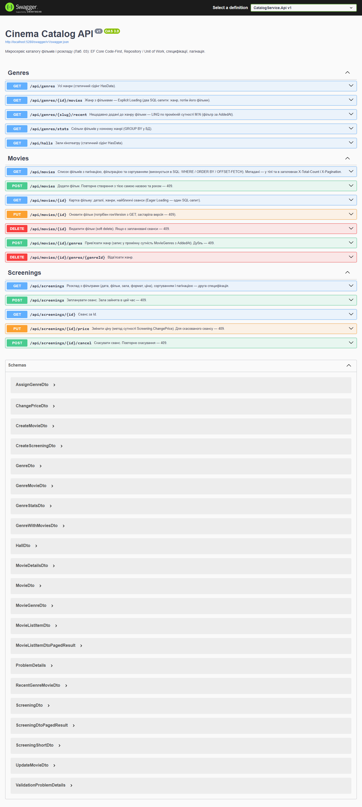
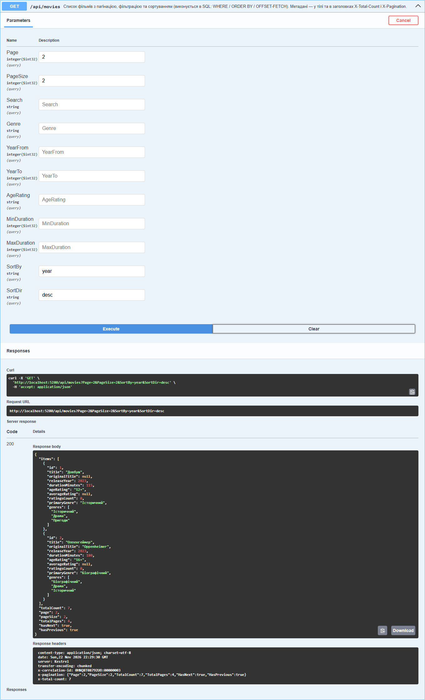
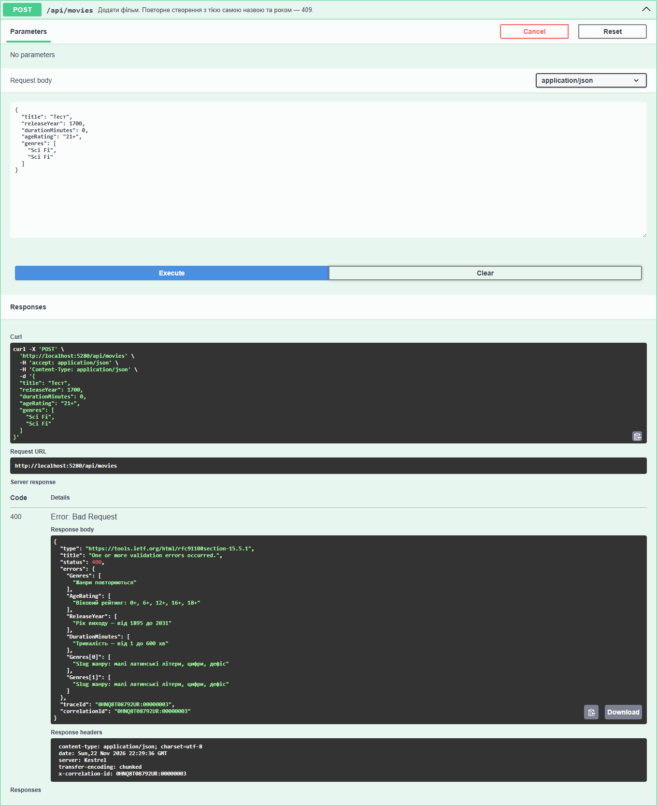
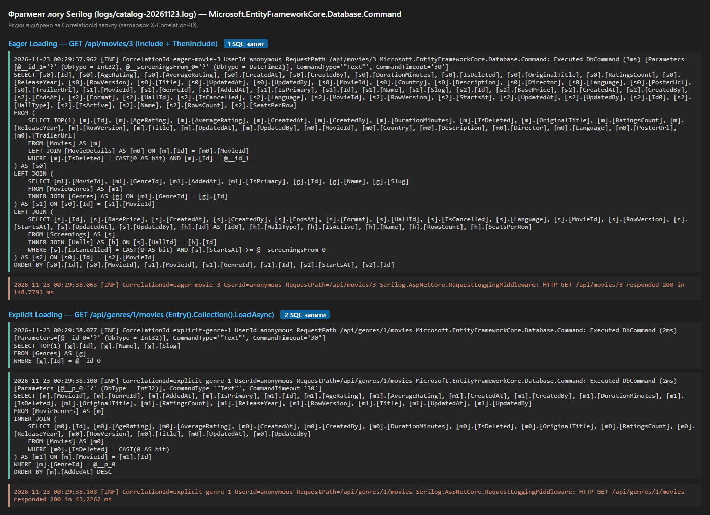

# Лаб. 03 — Тришарова архітектура на Entity Framework Core

Мікросервіс **каталогу фільмів і розкладу** кінотеатру на базі **Проєкту №2 з Лаб. 01** (`CinemaCatalog`), переписаний на **EF Core 9 (Code-First)**:

**Domain** (сутності з бізнес-методами) → **DAL** (DbContext, Fluent API, міграції, Generic Repository, Unit of Work) → **BLL** (сервіси, DTO, AutoMapper, FluentValidation, специфікації Ardalis) → **API** (контролери, ProblemDetails, Serilog, Swagger).

| Вимога | Де реалізовано |
|---|---|
| Сутності з бізнес-логікою | `Domain/Entities`: `Movie.AddGenre` (без дублів, один основний жанр), `Screening` (IMAX лише в IMAX-залі, ціна > 0, кінець = старт + тривалість + 15 хв), `Cancel`, `ChangePrice`… |
| Fluent API, окремий клас на сутність | `Dal/Configurations/*Configuration.cs` (`IEntityTypeConfiguration<T>`), підключення — `ApplyConfigurationsFromAssembly` |
| Зв'язки | 1:1 `Movie`–`MovieDetails`, 1:N `Movie`–`Screening`, `Hall`–`Screening`, M:N `Movie`–`Genre` через проміжну сутність `MovieGenre` (`AddedAt`, `IsPrimary`) |
| Міграції | `Dal/Migrations/…_InitialCreate.cs` + SQL-скрипти `db/InitialCreate.sql`, `db/InitialCreate.idempotent.sql` |
| Сідінг | `HasData` — довідники (7 жанрів, 3 зали); програмний ідемпотентний `DbInitializer` — фільми, деталі, жанри, сеанси |
| Async Generic Repository | `Dal/Repositories/GenericRepository.cs`: `AddAsync`, `GetByIdAsync`, `GetAllAsync`, `Update`, `Delete`, `SaveChangesAsync` + методи для специфікацій |
| Eager / Explicit / LINQ M:N | `MovieRepository.GetWithDetailsAsync` (Include/ThenInclude, **1 запит**), `GenreRepository.GetWithMoviesAsync` (Entry().Collection().LoadAsync, **2 запити**), `MovieGenreRepository` (фільтр за полем проміжної сутності) |
| Unit of Work | `Dal/UnitOfWork.cs` — один `SaveChangesAsync`, переклад помилок SQL (2601/2627/547, concurrency) у `ConflictException` |
| DTO + AutoMapper | `Bll/Dtos`, `Bll/Mapping/MappingProfiles.cs` (конфігурація перевіряється тестом `AssertConfigurationIsValid`) |
| Пагінація / фільтрація / сортування в SQL | `GET /api/movies`, `GET /api/screenings` — `WHERE / ORDER BY / OFFSET-FETCH`, метадані в тілі й заголовках |
| Валідація | DataAnnotations на DTO + FluentValidation (явний виклик у контролері) → `ValidationProblemDetails` |
| Обробка помилок | `GlobalExceptionHandler`: 404 / 400 / 409 у форматі ProblemDetails з `traceId` і `correlationId` |
| Логування | Serilog: структуровані логи, `CorrelationId`, `UserId`, `RequestPath`, SQL-команди EF Core, консоль + файл |
| Specification pattern | `Bll/Specifications`: `MoviesFilterSpec` і друга — `ScreeningsFilterSpec` (+ `ScreeningByIdSpec`, `ActiveScreeningsOfMovieSpec`) |
| Тести | 32 тести: unit (сутності, валідатори, специфікації, AutoMapper, сервіс з Moq), інтеграційні з SQL Server, API через `WebApplicationFactory` |

---

## 1. Що потрібно

* **.NET 9 SDK** (сервіс — `net9.0`). Для необов'язкового AppHost на Aspire — **.NET 10 SDK**.
* **SQL Server** — контейнер `cinema-mssql` з Лаб. 01 (`localhost,1433`) або будь-який інший.
* Інструмент **dotnet-ef** — локальний, прописаний у `dotnet-tools.json`:

```bash
dotnet tool restore
```

## 2. Запуск

```bash
cd Lab03-CatalogService
dotnet run --project src/CatalogService.Api
```

* Swagger: http://localhost:5280/swagger
* Рядок підключення — `ConnectionStrings:CatalogDb` у `src/CatalogService.Api/appsettings.json` (база `CinemaCatalogEf`). Можна перевизначити змінною оточення `ConnectionStrings__CatalogDb` або через `dotnet user-secrets`.
* На старті API **застосовує міграції** (`Database:MigrateOnStartup`, за замовчуванням `true`) і в Development **наповнює базу тестовими даними** (`Database:SeedOnStartup`). У Production програмний сідінг вимкнено.

Запуск разом із SQL Server у контейнері через .NET Aspire (необов'язково):

```bash
dotnet run --project src/CatalogService.AppHost      # Dashboard: http://localhost:15280
```



## 3. Міграції

Усі команди — з папки `Lab03-CatalogService`. Міграції лежать у проєкті DAL, стартовий проєкт — API (звідти береться рядок підключення).

```bash
# створити міграцію (так була створена InitialCreate)
dotnet ef migrations add InitialCreate --project src/CatalogService.Dal --startup-project src/CatalogService.Api --output-dir Migrations

# застосувати до бази
dotnet ef database update --project src/CatalogService.Dal --startup-project src/CatalogService.Api

# список міграцій і їхній стан
dotnet ef migrations list --project src/CatalogService.Dal --startup-project src/CatalogService.Api

# SQL-скрипт для DBA / прод-середовища
dotnet ef migrations script --project src/CatalogService.Dal --startup-project src/CatalogService.Api -o db/InitialCreate.sql
dotnet ef migrations script --idempotent --project src/CatalogService.Dal --startup-project src/CatalogService.Api -o db/InitialCreate.idempotent.sql

# відкат усіх міграцій (порожня база)
dotnet ef database update 0 --project src/CatalogService.Dal --startup-project src/CatalogService.Api
```

* `db/InitialCreate.sql` — звичайний скрипт міграції (таблиці, CHECK, унікальні та фільтровані індекси, `HasData`).
* `db/InitialCreate.idempotent.sql` — той самий скрипт з перевірками `__EFMigrationsHistory`, його можна запускати повторно.

Що задано у Fluent API (видно в скрипті): `CHECK`-обмеження (рік, тривалість, віковий рейтинг, ціна, формат, slug), унікальні індекси (`Genres.Name/Slug`, `Halls.Name`, `(HallId, StartsAt)`), фільтрований унікальний індекс `UQ_Movies_Title_Year` (`[IsDeleted] = 0`), покривні індекси з `INCLUDE`, `rowversion` для оптимістичної конкурентності, значення за замовчуванням `SYSUTCDATETIME()`, глобальний фільтр запитів `!IsDeleted` (soft delete), каскад лише там, де він безпечний (`Restrict` для сеансів).

## 4. Сідінг

| Тип | Що | Як |
|---|---|---|
| Статичний `HasData` | 7 жанрів, 3 зали | потрапляє в міграцію (`InsertData`) |
| Програмний `DbInitializer.SeedAsync` | 7 фільмів з деталями і жанрами, 10 сеансів | шукає фільм за назвою+роком і додає лише відсутнє — повторний запуск нічого не дублює (перевіряє тест `Seeding_is_idempotent`) |

## 5. API

| Метод | Шлях | Відповіді |
|---|---|---|
| GET | `/api/movies?page=&pageSize=&search=&genre=&yearFrom=&yearTo=&ageRating=&minDuration=&maxDuration=&sortBy=&sortDir=` | 200, 400 |
| GET | `/api/movies/{id}` — Eager Loading | 200, 404 |
| POST | `/api/movies` | 201 + `Location`, 400, 409 |
| PUT | `/api/movies/{id}` (з `rowVersion`) | 200, 400, 404, 409 |
| DELETE | `/api/movies/{id}` (soft delete) | 204, 404, 409 |
| POST / DELETE | `/api/movies/{id}/genres`, `/api/movies/{id}/genres/{genreId}` | 200/204, 400, 404, 409 |
| GET | `/api/genres`, `/api/genres/stats`, `/api/halls` | 200 |
| GET | `/api/genres/{id}/movies` — Explicit Loading | 200, 404 |
| GET | `/api/genres/{slug}/recent?since=` — LINQ по M:N | 200, 404 |
| GET | `/api/screenings?from=&to=&movieId=&hallId=&format=&maxPrice=&includeCancelled=&sortBy=&sortDir=&page=&pageSize=` | 200, 400 |
| GET / POST | `/api/screenings/{id}`, `/api/screenings` | 200/201, 400, 404, 409 |
| PUT / POST | `/api/screenings/{id}/price`, `/api/screenings/{id}/cancel` | 200/204, 400, 404, 409 |

Приклади запитів — у `src/CatalogService.Api/CatalogService.Api.http`.

### Пагінація

Сторінка за замовчуванням — 20 записів, максимум — 100. Фільтри, сортування і `Skip/Take` застосовуються в SQL (`OFFSET … FETCH`), `totalCount` рахується окремим `COUNT` з тими самими фільтрами.

```json
{
  "items": [ ... ],
  "totalCount": 7,
  "page": 2,
  "pageSize": 2,
  "totalPages": 4,
  "hasNext": true,
  "hasPrevious": true
}
```

Ті самі метадані — у заголовках `X-Total-Count` і `X-Pagination`. Сортування дозволене лише за полями зі списку (`title`, `year`, `duration`, `rating`, `created`), інше значення — 400.



### Валідація і помилки

1. **DataAnnotations** на DTO (`[Required]`, `[StringLength]`) — перевіряє `[ApiController]` ще до виклику методу.
2. **FluentValidation** — явний виклик `IValidator<T>.ValidateAsync` у контролері (діапазони року й тривалості, віковий рейтинг, slug і дублі жанрів, режисер обов'язковий разом з описом, сеанс лише в майбутньому й кратний 5 хв, дозволені поля сортування). Помилки додаються в `ModelState`, відповідь — `ValidationProblemDetails` з помилками по кожному полю.
3. **Винятки** обробляє `GlobalExceptionHandler`: `EntityNotFoundException` → 404, `ValidationException` → 400, `ConflictException` / `DomainException` → 409, решта → 500. Кожна відповідь — `application/problem+json` з `traceId` і `correlationId`.



## 6. Логування (Serilog)

Конфігурація — розділ `Serilog` в `appsettings.json`:

* `MinimumLevel.Default = Information`, `Microsoft = Warning`, але `Microsoft.EntityFrameworkCore.Database.Command = Information` — щоб бачити SQL, який генерує EF Core;
* sinks: консоль і файл `logs/catalog-YYYYMMDD.log` (щоденна ротація, 7 файлів);
* `LogContextMiddleware` додає до кожного запису `CorrelationId` (з заголовка `X-Correlation-ID` або `TraceIdentifier`, повертається у відповіді), `UserId`, `RequestPath`; `UseSerilogRequestLogging` — один підсумковий рядок на HTTP-запит.

Порівняння стратегій завантаження в лозі (повний фрагмент — `docs/sql-log-eager-vs-explicit.log`):



## 7. Specification pattern

Специфікація (Ardalis.Specification) збирає критерії, `Include`, сортування і пагінацію в одному класі BLL. Репозиторій лише застосовує її (`ListAsync(spec)`, `CountAsync(spec)`), тому контролери й сервіси не будують запити вручну, а специфікацію можна перевірити без бази (`spec.Evaluate(list)` у `SpecificationTests`).

* `MoviesFilterSpec` — пошук, жанр, роки, віковий рейтинг, тривалість, сортування, сторінка.
* `ScreeningsFilterSpec` — друга специфікація: період, фільм, зала, формат, максимальна ціна, скасовані, сортування, сторінка.

## 8. Тести

```bash
# усі тести; тести з базою потребують змінної CATALOG_TEST_DB (окрема тестова база, створюється міграціями)
set CATALOG_TEST_DB=Server=localhost,1433;Database=CinemaCatalogEf_Tests;User Id=sa;Password=<пароль>;TrustServerCertificate=True
dotnet test
```

Без `CATALOG_TEST_DB` тести з базою пропускаються, unit-тести виконуються. `verify.cmd` робить усе разом: збірка, міграція, SQL-скрипти, `database update`, тести (результат — `verify.log`). Останній прогін: **32 з 32 пройдено**.

Що перевіряють тести з розділу «перед здачею»:

* `page=2&pageSize=5` повертає `totalCount` усіх записів, а не сторінки;
* POST з порожнім `title` → 400 з помилкою поля `Title`; FluentValidation → 400 з помилками по полях;
* повторне створення → 409, неіснуючий id → 404 ProblemDetails, створення → 201 + `Location`;
* Eager Loading = 1 SQL-команда, Explicit Loading = 2 (лічильник через `DbCommandInterceptor`);
* сідінг ідемпотентний; друга специфікація працює через той самий generic-репозиторій.

## 9. Структура

```
Lab03-CatalogService/
├── src/
│   ├── CatalogService.Domain/     сутності, бізнес-правила, доменні винятки
│   ├── CatalogService.Dal/        DbContext, Configurations, Migrations, Repositories, UnitOfWork, Seeding
│   ├── CatalogService.Bll/        DTO, Validators, Specifications, Mapping, Services
│   ├── CatalogService.Api/        Controllers, Infrastructure (ProblemDetails, Serilog-контекст)
│   └── CatalogService.AppHost/    .NET Aspire (необов'язково)
├── tests/CatalogService.Tests/    Unit, Integration, Api
├── db/                            SQL-скрипти міграції
└── docs/                          знімки екрана, фрагмент логу, контрольні питання
```
