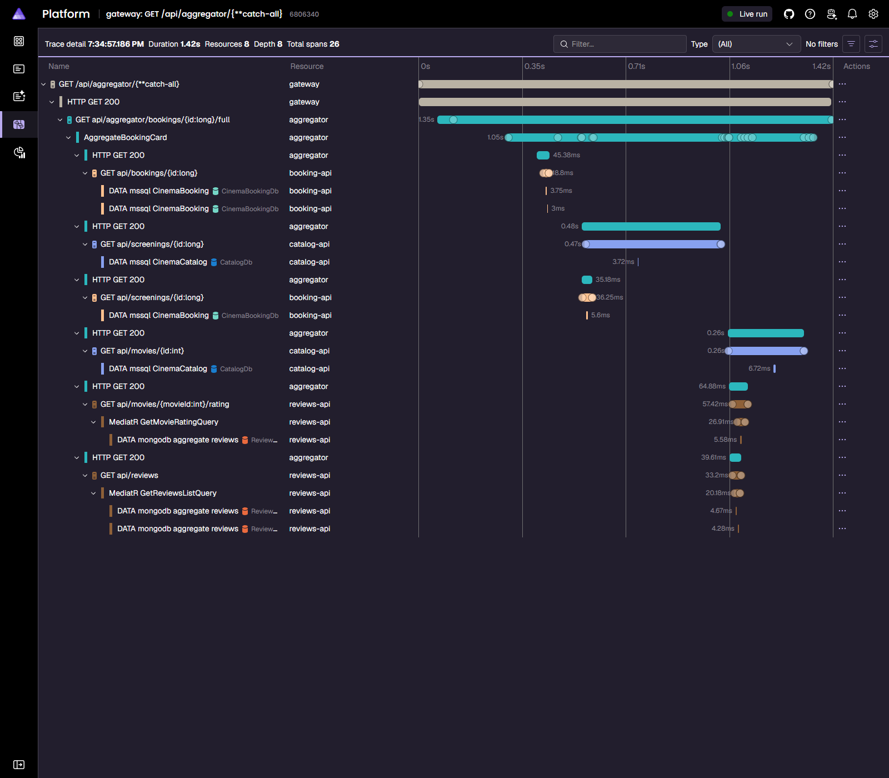

# Платформа «Кінотеатр» на .NET Aspire

Андрющенко Людмила, група 443-2. Лабораторна робота № 5: мікросервісна платформа з YARP Gateway, Aggregator і OpenTelemetry.

Кожна лабораторна робота лежить в окремій гілці від `main`: `lab-01` … `lab-05`. У гілці `lab-05` три сервіси з попередніх лаб зібрано в одне рішення `Platform.slnx` і запущено разом через Aspire AppHost.

## 1. Предметна область

Мережевий кінотеатр. Глядачі переглядають афішу, бронюють і оплачують місця на сеанси, після перегляду пишуть відгуки. Контент-менеджери ведуть каталог фільмів, залів і розклад. Детальний опис контекстів і агрегатів — у [docs/lab01-README.md](docs/lab01-README.md).

| Сервіс (ресурс Aspire) | Лаба | Технології | База (рядок підключення) | Що вміє |
|---|---|---|---|---|
| `booking-api` — [Services/Booking](Services/Booking) | Лаб. 02 | ADO.NET + Dapper, N-шарова (Api/Bll/Dal/Domain) | SQL Server `CinemaBooking` (`CinemaBookingDb`) | клієнти, бронювання, оплата, локальна копія сеансів |
| `catalog-api` — [Services/Catalog](Services/Catalog) | Лаб. 03 | EF Core, N-шарова | SQL Server `CinemaCatalog` (`CatalogDb`) | фільми, жанри, зали, розклад сеансів |
| `reviews-api` — [Services/Reviews](Services/Reviews) | Лаб. 04 | MongoDB.Driver, Clean Architecture + MediatR | MongoDB `cinema_reviews` (`ReviewsDb`) | відгуки, коментарі, рейтинг фільму, обговорення |
| `aggregator` — [Platform.Aggregator](Platform.Aggregator) | Лаб. 05 | typed HttpClient, Task.WhenAll | — | композитні відповіді з трьох сервісів |
| `gateway` — [Platform.ApiGateway](Platform.ApiGateway) | Лаб. 05 | YARP + service discovery | — | єдина точка входу `http://localhost:5000` |

## 2. Структура рішення

```
Platform.slnx
Platform.AppHost/          AppHost.cs — ресурси й зв'язки (бази, сервіси, Aggregator, Gateway)
Platform.ServiceDefaults/  Extensions.cs — Serilog, OpenTelemetry, health checks, service discovery, resilience
                           CorrelationId.cs — middleware + DelegatingHandler для X-Correlation-Id
Platform.ApiGateway/       YARP: маршрути в appsettings.json, логування маршрутизації
Platform.Aggregator/       Clients/ (typed HttpClients), Services/ (агрегація, часткові відмови), Controllers/
Services/Booking/          BookingService.Api | Bll | Dal | Domain | Tests
Services/Catalog/          CatalogService.Api | Bll | Dal | Domain | Tests
Services/Reviews/          Reviews.Domain | Application | Infrastructure | WebApi | Tests
db/p1  db/p2  db/p3        скрипти баз з Лаб. 01 (SQL Server ×2, MongoDB)
docs/                      ERD, приклади, скріни Лаб. 05, контрольні питання
```

Сервіси не переписувалися: у кожен `Program.cs` додано лише `builder.AddServiceDefaults()`, `app.UseCorrelationId()` і `app.MapDefaultEndpoints()`, а рядки підключення сервіси, як і раніше, читають з `ConnectionStrings:<ім'я>` (Aspire передає їх змінними середовища). Бізнес-логи й власні spans (`ActivitySource`) додано в `BookingService.Bll` (`Cinema.Booking`), `CatalogService.Bll` (`Cinema.Catalog`), `Reviews.Application` (`Cinema.Reviews`, span на кожен запит MediatR) і в Aggregator (`Cinema.Aggregator`).

## 3. Запуск платформи

Потрібно: .NET SDK 9 і 10, Docker Desktop (запущений).

```powershell
# один раз: пароль SQL Server — параметр-секрет AppHost (не зберігається в репозиторії)
dotnet user-secrets set "Parameters:sql-password" "<ваш-пароль>" --project Platform.AppHost

dotnet build Platform.slnx
dotnet run --project Platform.AppHost --launch-profile http
```

Якщо секрет не задано, Dashboard сам попросить ввести пароль. Те саме робить `docs/lab05/scripts/start-platform.cmd`.

| Що | Адреса |
|---|---|
| Aspire Dashboard (ресурси, traces, structured logs, metrics) | http://localhost:15500 |
| **API Gateway — єдина точка входу** | **http://localhost:5000** (список маршрутів: `GET /`) |
| Swagger сервісів (напряму, для налагодження) | booking `:5180`, catalog `:5280`, reviews `:5380`, aggregator `:5400` |

Порядок старту задано `WaitFor`: контейнери SQL Server і MongoDB → `booking-api`, `catalog-api`, `reviews-api` → `aggregator` → `gateway`.

### Як розгортаються бази

AppHost піднімає два контейнери з постійними томами (`cinema-platform-sql-data`, `cinema-platform-mongo-data`, `ContainerLifetime.Persistent`), тож дані переживають перезапуск:

* `CinemaBooking` — `booking-api` на старті виконує скрипти з [db/p1](db/p1) (`schema.sql` → `procedures.sql` → `seed.sql`, вбудовані ресурси Dal, ідемпотентні);
* `CinemaCatalog` — `catalog-api` застосовує міграції EF Core і програмний сідінг;
* `cinema_reviews` — `reviews-api` створює індекси й засіває колекції (`IHostedService`).

Окремо від Aspire бази можна розгорнути скриптом Лаб. 01: `db/deploy.ps1 -Tests` (або `db/run-deploy-tests.cmd`) — він піднімає `db/docker-compose.yml` і виконує `db/init.sql`, `db/p1/*`, `db/p2/*`, `db/p3/*`.

### Тести

```powershell
dotnet test Platform.slnx
```
Інтеграційні тести з реальною БД пропускаються, якщо не задано змінні `CATALOG_TEST_DB`, `REVIEWS_TEST_MONGO` (див. README сервісів).

## 4. Маршрути Gateway

Маршрути описано в [Platform.ApiGateway/appsettings.json](Platform.ApiGateway/appsettings.json). Адреси кластерів — логічні імена ресурсів (`http://booking-api` тощо), їх розв'язує service discovery (`AddServiceDiscoveryDestinationResolver`).

| Шлях | Сервіс | Примітка |
|---|---|---|
| `/api/aggregator/{**catch-all}` | aggregator | окремий маршрут, `Order: 1` |
| `/api/movies/{movieId:int}/rating`, `/api/movies/{movieId:int}/title` | reviews-api | `Order: 1`, щоб не потрапити в загальний `/api/movies` |
| `/api/movies/**`, `/api/screenings/**`, `/api/genres/**`, `/api/halls/**` | catalog-api | `Order: 10` |
| `/api/bookings/**`, `/api/customers/**` | booking-api | |
| `/api/booking/screenings/**` | booking-api | transform → `/api/screenings/**` (локальна копія сеансів) |
| `/api/reviews/**`, `/api/discussions/**` | reviews-api | ліміт тіла запиту 256 КБ |

Gateway пише для кожного запиту лог маршрутизації (метод, шлях, маршрут, кластер, адреса, статус, тривалість, розмір), а якщо сервіс недоступний — Warning з помилкою YARP.

### Приклади

```bash
curl http://localhost:5000/api/movies?pageSize=3
curl http://localhost:5000/api/bookings/1
curl http://localhost:5000/api/movies/3/rating
curl -H "X-Correlation-Id: demo-1" -i http://localhost:5000/api/aggregator/bookings/1/full
curl http://localhost:5000/api/aggregator/movies/3/full

curl -X POST http://localhost:5000/api/bookings -H "Content-Type: application/json" \
     -d '{"customerId":"6f1c2a10-0000-4000-8000-000000000002","screeningId":2,"seats":[{"row":5,"seat":3}],"channel":"Web"}'
```

Кожна відповідь містить `X-Correlation-Id` (переданий клієнтом або згенерований Gateway) і `X-Trace-Id` (id trace в Dashboard).

## 5. Aggregator

| Ендпоінт | Що збирає |
|---|---|
| `GET /api/aggregator/bookings/{id}/full` | бронювання (booking) → паралельно живі дані сеансів (catalog) і локальні копії сеансів (booking) → паралельно фільми (catalog), рейтинг і топ-відгуки (reviews) |
| `GET /api/aggregator/movies/{movieId}/full` | фільм, найближчі сеанси, рейтинг і відгуки — 4 виклики в `Task.WhenAll` |

* Typed HttpClients з адресами `https+http://booking-api` тощо; `CancellationToken` передається до кожного виклику; `.Result`/`Task.WaitAll` не використовуються.
* Resilience (`AddStandardResilienceHandler`): спроба 2 с, 1 повтор, загалом 6 с, circuit breaker.
* Кожен виклик логується з тривалістю (`"reviews-api" "рейтинг фільму 3" — відповідь за 97 мс`).
* **Часткові відмови:** якщо обов'язковий сервіс (booking для картки бронювання) недоступний — 503; якщо недоступний необов'язковий — відповідь 200 з наявними даними та списком `warnings`, без 500.
* Композитний DTO у camelCase, null-поля не серіалізуються.

Приклад повної відповіді: [docs/lab05/aggregate-booking.json](docs/lab05/aggregate-booking.json); часткової (reviews-api зупинено): [docs/lab05/aggregate-booking-partial.json](docs/lab05/aggregate-booking-partial.json).

## 6. Спостережуваність

* **Serilog** (у ServiceDefaults): збагачення `ServiceName`, `Environment`, `MachineName`, `ThreadId`, `FromLogContext`; рівні Debug у Development / Information в інших середовищах; консоль у `CompactJsonFormatter`; `writeToProviders: true`, тож ті самі логи йдуть через OpenTelemetry у Dashboard.
* **CorrelationId:** middleware бере `X-Correlation-Id` з запиту або генерує новий, кладе в `LogContext` і тег span; `CorrelationIdHandler` (DelegatingHandler) передає його далі у вихідні HTTP-запити.
* **OpenTelemetry:** ASP.NET Core, HttpClient, SqlClient, MongoDB (`DiagnosticsActivityEventSubscriber`), Runtime; власні джерела `Cinema.*`; експорт `UseOtlpExporter()` в Aspire Dashboard.

| Скрін | Що видно |
|---|---|
|  | усі ресурси в стані Running |
|  | один trace: gateway → aggregator → booking/catalog/reviews → SQL і MongoDB; паралельні виклики перекриваються |
|  | Structured logs з фільтром `CorrelationId = demo-aggregate-booking`: записи всіх сервісів одного запиту |
|  | reviews-api зупинено: виклики до нього червоні, а запит усе одно 200 |
|  | Warning «reviews-api недоступний…» і картка з 2 попередженнями |
|  | стан ресурсів під час демонстрації часткової відмови |

Сценарій, яким зроблено скріни, — [docs/lab05/scripts/demo.js](docs/lab05/scripts/demo.js), його вивід — [docs/lab05/demo-output.txt](docs/lab05/demo-output.txt).

## 7. Політика дублювання даних

Кожне поле має одного власника; інші сервіси зберігають знімок або копію (з Лаб. 01).

| Поле | Де зберігається | Власник | Політика |
|---|---|---|---|
| `Tickets.MovieTitle`, `HallName`, `StartsAt`, `UnitPrice` | CinemaBooking | Каталог | знімок на момент бронювання, не оновлюється |
| `Screenings.*` (MovieId, MovieTitle, HallName, StartsAt, BasePrice, IsActive …) | CinemaBooking | Каталог | копія; оновлюватиметься подіями `ScreeningChanged` тощо (Лаб. 08) |
| `reviews.movieTitle`, `discussions.movieTitle` | cinema_reviews | Каталог | копія, оновлюється подією `MovieRenamed` |
| `author.displayName` | cinema_reviews | Бронювання (Customers.FullName) | копія, оновлюється подією `CustomerRenamed` |
| `reviews.verifiedViewer` | cinema_reviews | Бронювання | знімок факту перегляду |
| `Movies.AverageRating`, `RatingsCount` | CinemaCatalog | Відгуки | копія, оновлюється подією `MovieRatingChanged` |

Aggregator нічого не зберігає: він читає актуальні дані у власників і показує розбіжності (наприклад, сеанс скасовано в каталозі, а в копії booking — ні) як `warnings`.

## 8. Документи

* [docs/lab05-control-questions.md](docs/lab05-control-questions.md) — відповіді на контрольні питання Лаб. 05;
* [docs/lab01-README.md](docs/lab01-README.md), [docs/lab01-control-questions.md](docs/lab01-control-questions.md) — бази даних (Лаб. 01);
* README сервісів: [Booking](Services/Booking/README.md), [Catalog](Services/Catalog/README.md), [Reviews](Services/Reviews/README.md).
