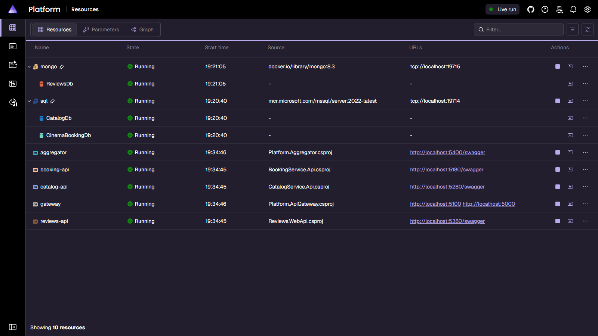
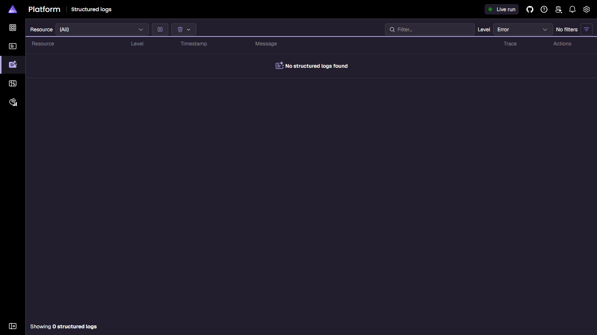
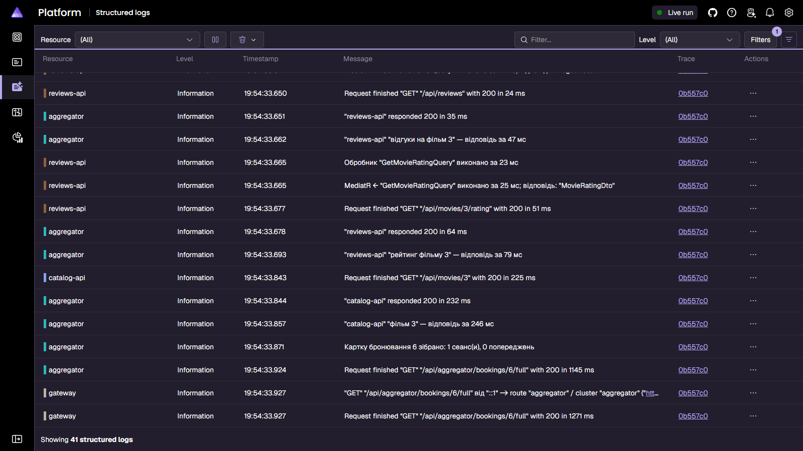
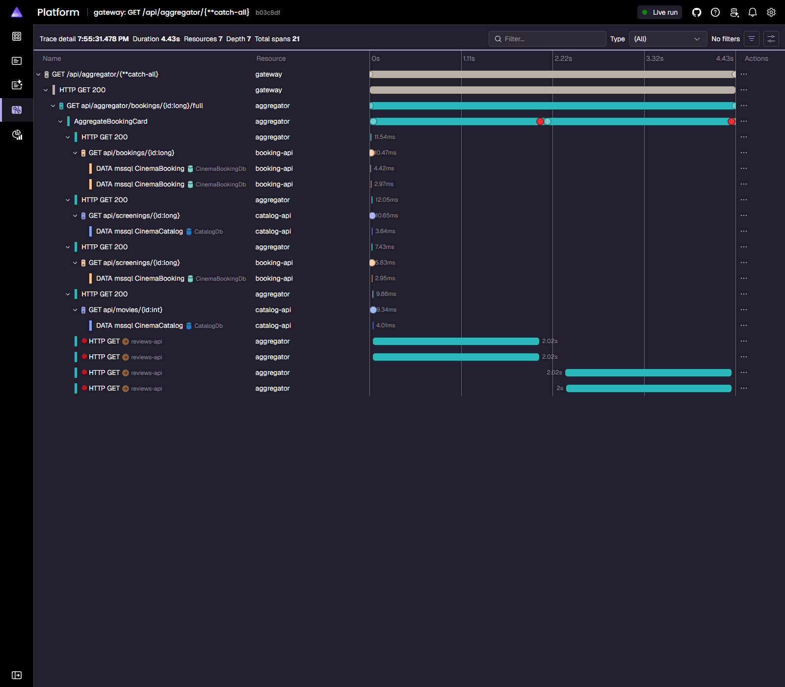
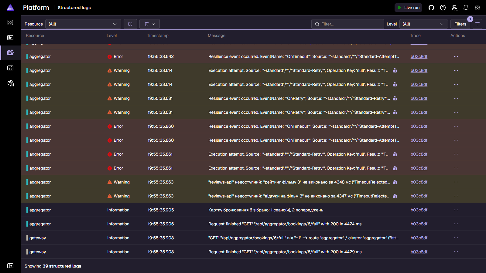
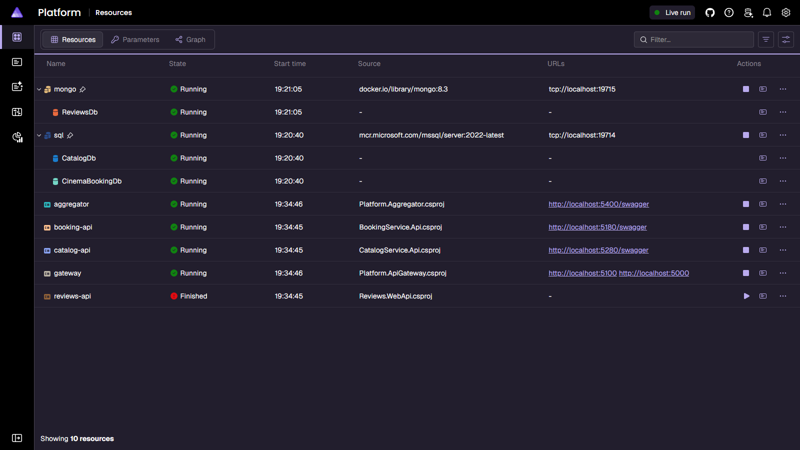

# Платформа «Кінотеатр» на .NET Aspire

Андрющенко Людмила, група 443-2.
Лабораторна робота № 5: мікросервісна платформа з YARP Gateway, Aggregator і OpenTelemetry.
Лабораторна робота № 6: gRPC-виклики та дворівневе кешування (Memory + Redis) — **розділ [7](#7-лаб-06-grpc-і-дворівневе-кешування)**.
Лабораторна робота № 7: резильєнтність (Polly), бізнес-метрики та health checks — **розділ [8](#8-лаб-07-резильєнтність-бізнес-метрики-та-health-checks)**.
Лабораторна робота № 8: подієва архітектура з RabbitMQ — **розділ [9](#9-лаб-08-подієва-архітектура-з-rabbitmq)**.

Кожна лабораторна робота лежить в окремій гілці від `main`: `lab-01` … `lab-08`. Гілка `lab-08` продовжує `lab-07`, `lab-07` — `lab-06`, а та — `lab-05`: три сервіси з попередніх лаб зібрано в одне рішення `Platform.slnx` і запущено разом через Aspire AppHost.

## 1. Предметна область

Мережевий кінотеатр. Глядачі переглядають афішу, бронюють і оплачують місця на сеанси, після перегляду пишуть відгуки. Контент-менеджери ведуть каталог фільмів, залів і розклад. Детальний опис контекстів і агрегатів — у [docs/lab01-README.md](docs/lab01-README.md).

| Сервіс (ресурс Aspire) | Лаба | Технології | База (рядок підключення) | Що вміє |
|---|---|---|---|---|
| `booking-api` — [Services/Booking](Services/Booking) | Лаб. 02 | ADO.NET + Dapper, N-шарова (Api/Bll/Dal/Domain) | SQL Server `CinemaBooking` (`CinemaBookingDb`) | клієнти, бронювання, оплата, локальна копія сеансів |
| `catalog-api` — [Services/Catalog](Services/Catalog) | Лаб. 03 | EF Core, N-шарова | SQL Server `CinemaCatalog` (`CatalogDb`) | фільми, жанри, зали, розклад сеансів |
| `reviews-api` — [Services/Reviews](Services/Reviews) | Лаб. 04 | MongoDB.Driver, Clean Architecture + MediatR | MongoDB `cinema_reviews` (`ReviewsDb`) | відгуки, коментарі, рейтинг фільму, обговорення |
| `aggregator` — [Platform.Aggregator](Platform.Aggregator) | Лаб. 05–06 | gRPC-клієнти (Лаб. 06), Task.WhenAll, Redis | — | композитні відповіді з трьох сервісів |
| `redis` | Лаб. 06 | Redis (контейнер Aspire, том) | `ConnectionStrings:redis` | L2 дворівневого кешу сервісів, кеш агрегованих відповідей |
| `messaging` | Лаб. 08 | RabbitMQ (контейнер Aspire, том, Management UI `http://localhost:15672`) | `ConnectionStrings:messaging` | інтеграційні події Каталогу → копії в Бронюванні й Відгуках |
| `gateway` — [Platform.ApiGateway](Platform.ApiGateway) | Лаб. 05 | YARP + service discovery | — | єдина точка входу `http://localhost:5000` |

## 2. Структура рішення

```
Platform.slnx
Platform.AppHost/          AppHost.cs — ресурси й зв'язки (бази, сервіси, Aggregator, Gateway)
Platform.ServiceDefaults/  Extensions.cs — Serilog, OpenTelemetry, health checks (live / ready / startup), service discovery, resilience
                           CorrelationId.cs — middleware + DelegatingHandler для X-Correlation-Id
Platform.ApiGateway/       YARP: маршрути в appsettings.json, логування маршрутизації
Platform.Aggregator/       Clients/ (HTTP- і gRPC-клієнти), Services/ (агрегація, часткові відмови), Controllers/,
                           Resilience/ (політики стійкості), Metrics/, HealthChecks/ (Лаб. 07)
Platform.Messaging/        Лаб. 08: IntegrationEvent, IEventPublisher + RabbitMqEventPublisher, EventTopology (exchange, черги, DLX/DLQ),
                           IntegrationEventConsumer (ack / retry / DLQ), TracePropagation (W3C traceparent), метрики
Services/Booking/          BookingService.Api (Protos/, Grpc/, Metrics/, HealthChecks/, Messaging/) | Bll (IntegrationEvents/) | Dal | Domain | Tests
Services/Catalog/          CatalogService.Api (Protos/, Grpc/, Metrics/, HealthChecks/) | Bll (IntegrationEvents/) | Dal | Domain | Tests
Services/Reviews/          Reviews.Domain | Application | Infrastructure | WebApi (Protos/, Grpc/, Metrics/, HealthChecks/, IntegrationEvents/, Messaging/) | Tests
db/p1  db/p2  db/p3        скрипти баз з Лаб. 01 (SQL Server ×2, MongoDB)
docs/                      ERD, приклади, скріни Лаб. 05, контрольні питання
```

### Що змінено в коді сервісів

Бізнес-логіка сервісів не змінювалася. Рядки підключення сервіси, як і раніше, читають через `GetConnectionString("<ім'я>")`, а резервні значення лишилися в `appsettings.json`; Aspire передає справжні змінними середовища `ConnectionStrings__<ім'я>`.

| Де | Що зроблено | Навіщо |
|---|---|---|
| `Program.cs` трьох сервісів | `builder.AddServiceDefaults()`, `app.UseCorrelationId()`, `app.MapDefaultEndpoints()`; прибрано власні `UseSerilog`, `UseSerilogRequestLogging` і middleware CorrelationId | інтеграція з платформою; власна конфігурація Serilog і CorrelationId дублювала ServiceDefaults |
| `appsettings*.json` сервісів | видалено секції `Serilog` | логування налаштовує ServiceDefaults |
| `*.Api` csproj | посилання на `Platform.ServiceDefaults` замість пакета Serilog | |
| `BookingService.Bll`, `CatalogService.Bll`, `Reviews.Application` | бізнес-логи з властивостями (`BookingId`, `Status`, `Amount`, `MovieId`, `ScreeningId`, `ReviewId`) і власні spans `ActivitySource` (`Cinema.Booking`, `Cinema.Catalog`, `Cinema.Reviews` — span на кожен запит MediatR) | вимога «логування бізнес-подій і власні spans» |
| Контролери (`*.Api/Controllers`, `Reviews.WebApi/Controllers`) | лог бізнес-події і теги (`booking.id`, `movie.id`, `review.id`) на span HTTP-запиту для операцій запису | те саме, на рівні API |
| `Reviews.Infrastructure/Persistence/MongoDbOptions` | гачок `ConfigureClientSettings`, через який `Program.cs` підписує `DiagnosticsActivityEventSubscriber` | MongoDB-spans у trace; клієнт Mongo створюється всередині Infrastructure, тож інакше підписатися неможливо |

Чутливі дані (email, телефон, номер картки) у логи й теги не пишуться.

## 3. Запуск платформи

Потрібно: .NET SDK 9 і 10, Docker Desktop (запущений).

```powershell
# один раз: пароль SQL Server — параметр-секрет AppHost (не зберігається в репозиторії)
dotnet user-secrets set "Parameters:sql-password" "<ваш-пароль>" --project Platform.AppHost
# пароль RabbitMQ (Parameters:messaging-password) Aspire генерує сам і зберігає в тих самих user secrets

dotnet build Platform.slnx
dotnet run --project Platform.AppHost --launch-profile http
```

Якщо секрет не задано, Dashboard сам попросить ввести пароль. Те саме робить `docs/lab05/scripts/start-platform.cmd`.

| Що | Адреса |
|---|---|
| Aspire Dashboard (ресурси, traces, structured logs, metrics) | http://localhost:15500 |
| **API Gateway — єдина точка входу** | **http://localhost:5000** (список маршрутів: `GET /`) |
| Swagger сервісів (напряму, для налагодження) | booking `:5180`, catalog `:5280`, reviews `:5380`, aggregator `:5400` |
| gRPC сервісів (лише HTTP/2, для Aggregator) | booking `:5181`, catalog `:5281`, reviews `:5381` |
| RabbitMQ Management UI (Лаб. 08) | http://localhost:15672 — користувач `guest`, пароль: `dotnet user-secrets list --project Platform.AppHost` → `Parameters:messaging-password` |

Порядок старту задано `WaitFor`: контейнери SQL Server, MongoDB, Redis і RabbitMQ → `booking-api`, `catalog-api`, `reviews-api` → `aggregator` → `gateway`.

### Як розгортаються бази

AppHost піднімає два контейнери з постійними томами (`cinema-platform-sql-data`, `cinema-platform-mongo-data`, `ContainerLifetime.Persistent`), тож дані переживають перезапуск:

* `CinemaBooking` — `booking-api` на старті виконує скрипти з [db/p1](db/p1) (`schema.sql` → `procedures.sql` → `seed.sql`, вбудовані ресурси Dal, ідемпотентні);
* `CinemaCatalog` — `catalog-api` застосовує міграції EF Core і програмний сідінг;
* `cinema_reviews` — `reviews-api` створює індекси й засіває колекції (`IHostedService`).
* Лаб. 08: у базі CinemaBooking, створеній раніше, `booking-api` на старті доповнює схему пакетами `schema.sql` з позначкою «Лаб. 08 (оновлення схеми)» — таблиця `dbo.ProcessedEvents`, стовпці `PriceSyncedAt` / `TitleSyncedAt`; у `cinema_reviews` `reviews-api` створює TTL-індекс колекції `processedEvents`.

Окремо від Aspire бази можна розгорнути скриптом Лаб. 01: `db/deploy.ps1 -Tests` (або `db/run-deploy-tests.cmd`) — він піднімає `db/docker-compose.yml` і виконує `db/init.sql`, `db/p1/*`, `db/p2/*`, `db/p3/*`.

### Тести

```powershell
dotnet test Platform.slnx
```
Інтеграційні й API-тести з реальною БД пропускаються, якщо не задано змінні `CINEMA_TEST_DB`, `CATALOG_TEST_DB`, `REVIEWS_TEST_MONGO` (див. README сервісів). З базами Лаб. 01 (контейнери `cinema-mssql`, `cinema-mongo`) останній прогін: **151 з 151** (Booking 42, Catalog 49, Reviews 60).

### Docker-образи

`Platform.ApiGateway/Dockerfile` і `Services/Catalog/CatalogService.Api/Dockerfile` збираються з кореня репозиторію (потрібні `Directory.Build.props` і `Platform.ServiceDefaults`):

```powershell
docker build -f Platform.ApiGateway/Dockerfile -t cinema-gateway .
docker build -f Services/Catalog/CatalogService.Api/Dockerfile -t cinema-catalog-api .
```

## 4. Маршрути Gateway

Маршрути описано в [Platform.ApiGateway/appsettings.json](Platform.ApiGateway/appsettings.json). Адреси кластерів — логічні імена ресурсів (`http://booking-api` тощо), їх розв'язує service discovery (`AddServiceDiscoveryDestinationResolver`).

| Шлях | Сервіс | Примітка |
|---|---|---|
| `/api/aggregator/{**catch-all}` | aggregator | окремий маршрут, `Order: 1` |
| `/api/movies/{movieId:int}/rating`, `/api/movies/{movieId:int}/title` | reviews-api | `Order: 1`, щоб не потрапити в загальний `/api/movies` |
| `/api/movies/**`, `/api/screenings/**`, `/api/genres/**`, `/api/halls/**` | catalog-api | `Order: 10` |
| `/api/bookings/**`, `/api/customers/**` | booking-api | |
| `/api/booking/screenings/**` | booking-api | transform → `/api/screenings/**` (локальна копія сеансів) |
| `/api/reviews/**`, `/api/discussions/**` | reviews-api | ліміт тіла запиту 256 КБ |

Gateway пише для кожного запиту лог маршрутизації (метод, шлях, маршрут, кластер, адреса, статус, тривалість, розмір), а якщо сервіс недоступний — Warning з помилкою YARP.

### Приклади

```bash
curl http://localhost:5000/api/movies?pageSize=3
curl http://localhost:5000/api/bookings/1
curl http://localhost:5000/api/movies/3/rating
curl -H "X-Correlation-Id: demo-1" -i http://localhost:5000/api/aggregator/bookings/1/full
curl http://localhost:5000/api/aggregator/movies/3/full

curl -X POST http://localhost:5000/api/bookings -H "Content-Type: application/json" \
     -d '{"customerId":"6f1c2a10-0000-4000-8000-000000000002","screeningId":2,"seats":[{"row":5,"seat":3}],"channel":"Web"}'
```

Кожна відповідь містить `X-Correlation-Id` (переданий клієнтом або згенерований Gateway) і `X-Trace-Id` (id trace в Dashboard).

## 5. Aggregator

| Ендпоінт | Що збирає |
|---|---|
| `GET /api/aggregator/bookings/{id}/full` | бронювання (booking) → паралельно живі дані сеансів (catalog) і локальні копії сеансів (booking) → паралельно фільми (catalog), рейтинг і топ-відгуки (reviews) |
| `GET /api/aggregator/movies/{movieId}/full` | фільм, найближчі сеанси, рейтинг і відгуки — 4 виклики в `Task.WhenAll` |

* (Лаб. 05; з Лаб. 06 основний транспорт — gRPC, див. [7.4](#74-aggregator-на-grpc)) Typed HttpClients з адресами `https+http://booking-api` тощо; `CancellationToken` передається до кожного виклику; `.Result`/`Task.WaitAll` не використовуються.
* Resilience: окрема політика для кожного клієнта відповідно до критичності сервісу — розділ [8.2](#82-resilience-у-aggregator).
* Кожен виклик логується з тривалістю (`"reviews-api" "рейтинг фільму 3" — відповідь за 97 мс`).
* **Часткові відмови:** якщо обов'язковий сервіс (booking для картки бронювання) недоступний — 503; якщо недоступний необов'язковий — відповідь 200 з наявними даними та списком `warnings`, без 500.
* Композитний DTO у camelCase, null-поля не серіалізуються.

Приклад повної відповіді: [docs/lab05/aggregate-booking.json](docs/lab05/aggregate-booking.json); часткової (reviews-api зупинено): [docs/lab05/aggregate-booking-partial.json](docs/lab05/aggregate-booking-partial.json).

## 6. Спостережуваність

* **Serilog** (у ServiceDefaults): збагачення `ServiceName`, `Environment`, `MachineName`, `ThreadId`, `FromLogContext`; рівні Debug у Development / Information в інших середовищах; консоль у `CompactJsonFormatter`; `writeToProviders: true`, тож ті самі логи йдуть через OpenTelemetry у Dashboard.
* **CorrelationId:** middleware бере `X-Correlation-Id` з запиту або генерує новий, кладе в `LogContext` і тег span; `CorrelationIdHandler` (DelegatingHandler) передає його далі у вихідні HTTP-запити.
* **OpenTelemetry:** ASP.NET Core, HttpClient, SqlClient, MongoDB (`DiagnosticsActivityEventSubscriber`), Runtime; власні джерела `Cinema.*`; експорт `UseOtlpExporter()` в Aspire Dashboard.

| Скрін | Що видно |
|---|---|
|  | усі ресурси в стані Running |
|  | Structured logs з рівнем Error після чистого старту (без томів) і всього сценарію: жодного запису |
|  | один trace: gateway → aggregator → booking/catalog/reviews → SQL і MongoDB; паралельні виклики перекриваються |
|  | Structured logs з фільтром `CorrelationId = demo-aggregate-booking`: записи всіх сервісів одного запиту |
|  | reviews-api зупинено: виклики до нього червоні, а запит усе одно 200 |
|  | Warning «reviews-api недоступний…» і картка з 2 попередженнями |
|  | стан ресурсів під час демонстрації часткової відмови |

Сценарій, яким зроблено скріни, — [docs/lab05/scripts/demo.js](docs/lab05/scripts/demo.js), його вивід — [docs/lab05/demo-output.txt](docs/lab05/demo-output.txt).

## 7. Лаб. 06: gRPC і дворівневе кешування

### 7.1. Де що лежить

| Що | Де |
|---|---|
| Redis в AppHost: `AddRedis("redis").WithDataVolume(...)`, сервіси й Aggregator — `WithReference(redis).WaitFor(redis)` | [Platform.AppHost/AppHost.cs](Platform.AppHost/AppHost.cs) |
| Контракти gRPC (proto3, `package`, `csharp_namespace`) | [catalog.proto](Services/Catalog/CatalogService.Api/Protos/catalog.proto), [booking.proto](Services/Booking/BookingService.Api/Protos/booking.proto), [reviews.proto](Services/Reviews/Reviews.WebApi/Protos/reviews.proto) |
| gRPC-сервіси (адаптери над BLL / MediatR, RpcException з правильними кодами) | `Services/*/<Сервіс>.Api/Grpc/` (`CatalogGrpcService`, `BookingGrpcService`, `ReviewsGrpcService`) |
| `AddGrpc` + серверний interceptor логування, `MapGrpcService<T>()` | [ServiceDefaults/Grpc](Platform.ServiceDefaults/Grpc), `Program.cs` сервісів |
| `AddMemoryCache` зі `SizeLimit`, `AddRedisDistributedCache("redis")` | `Program.cs` сервісів |
| Дворівневий кеш L1 → L2 → БД, ключі, TTL, метрики, health check, прогрівання | `Caching/` у [CatalogService.Bll](Services/Catalog/CatalogService.Bll/Caching), [BookingService.Bll](Services/Booking/BookingService.Bll/Caching), [Reviews.Application](Services/Reviews/Reviews.Application/Caching) |
| Інвалідація при записі | `MovieService`, `ScreeningService` (Catalog.Bll), `BookingsService`, `ScreeningService` (Booking.Bll), команди `Reviews.Application/Reviews/Commands` |
| gRPC-клієнти Aggregator (`AddGrpcClient`, `GrpcServices="Client"`), паралельні виклики, часткові відмови, кеш агрегованих відповідей | [Platform.Aggregator](Platform.Aggregator) (`Program.cs`, `Clients/GrpcServiceSources.cs`, `Services/PartialResults.cs`, `Services/AggregateCache.cs`) |
| Meter-и кешу й gRPC у експорті OTLP | [ServiceDefaults/Extensions.cs](Platform.ServiceDefaults/Extensions.cs) (`CacheMeters`, `GrpcMeters`) |

### 7.2. Дворівневий кеш

```
GET /api/movies/3 ──► IMemoryCache (L1, процес) ──промах──► Redis (L2, спільний) ──промах──► SQL Server
                          ▲  заповнюється на зворотному шляху  ◄──────────────────────────────┘
```

* **Cache-aside**: `ITwoLevelCache.GetOrCreateAsync(key, policy, factory)`; REST-контролер і gRPC-сервіс викликають той самий BLL, тож кеш спільний для обох протоколів. У Reviews кешування зроблено `CachingBehavior` у pipeline MediatR для запитів `ICacheableQuery`.
* **Ключі** з префіксом сервісу: `catalog:movie:{id}`, `catalog:screening:{id}`, `catalog:genres`, `booking:screening:{id}`, `booking:booking:{id}`, `reviews:movie:{id}:rating`, `reviews:review:{id}`. Списки з фільтрами — через ключ-версію: `catalog:movies:list:v{версія}:{хеш параметрів}`.
* **L1** (`IMemoryCache`): `SizeLimit` (1 одиниця = 1 КБ JSON), `CompactionPercentage = 0.2`, пріоритети (довідники — High, списки — Low), sliding + absolute expiration. **L2** (Redis): DTO у JSON (System.Text.Json), absolute TTL. **L1 завжди коротший за L2**:

  | Політика | L1 | L2 | Дані |
  |---|---|---|---|
  | reference | 10 хв | 1 год | жанри, зали, копії сеансів у booking |
  | card | 45 с sliding / 2 хв | 10 хв | картка фільму, сеанс |
  | rating | 30 с sliding / 1 хв | 5 хв | рейтинг фільму (aggregation pipeline) |
  | list | 30 с | 2 хв | сторінки списків |
  | personal | 10 с | 30 с | картка бронювання (email, телефон — лише короткий TTL) |
* **Інвалідація** синхронно після `SaveChanges` / коміту: картка + версія списків; причина в лозі (`Cache invalidated ["catalog:movie:3"], reason MovieUpdated`) і в метриці `cache.invalidations`.
* **Збій Redis** не ламає запит: помилка → Warning, `cache.errors`, запит іде в БД, L2 пропускається 30 с (щоб не чекати тайм-аут на кожному запиті). Тайм-аути клієнта Redis — 1–2 с.
* **Прогрівання**: `CacheWarmupService` (BackgroundService) завантажує жанри, зали й першу сторінку афіші на старті й раз на 10 хв; `DistributedCacheWarmup` відкриває з'єднання з Redis під час старту сервісу.
* **Статистика L1** — у `/health` (`catalog-cache`, `booking-cache`, `reviews-cache`: записи, розмір, попадання, промахи, hit ratio).
* **Порівняння з HybridCache** (`Microsoft.Extensions.Caching.Hybrid`): робить те саме L1 + L2 і додатково захищає від одночасного перерахунку одного ключа (stampede) та підтримує теги для інвалідації груп. Ручна реалізація тут — щоб явно показати кроки й мати власні метрики L1/L2; ключ-версія замінює теги.

### 7.3. gRPC

* Сервіси слухають **два порти Kestrel** (`appsettings.json` → `Kestrel:Endpoints`): REST — HTTP/1.1 для Gateway, gRPC — лише `Http2` (h2c без TLS). В AppHost це іменований ендпоінт `grpc`; Aggregator звертається за адресою `http://_grpc.<сервіс>` (service discovery вибирає саме його).
* Методи для Aggregator — насамперед читання, зокрема пакетні (`GetMoviesByIds`, `GetScreeningsByIds`, `GetRatingsForMovies`). Гроші — `Money { units, nanos }`, час — `google.protobuf.Timestamp`, необов'язкові поля — `optional`.
* Валідація входу (`Id <= 0` → `InvalidArgument`), доменні винятки → `NotFound` / `FailedPrecondition`, решта → `Internal` з логом. Перевірено тестами `GrpcServiceTests` і запитом до неіснуючого фільму (Aggregator отримує `NOT_FOUND` і повертає 404).
* Серверний interceptor логує метод, peer, статус, тривалість і CorrelationId структурованими властивостями; помилки — Warning / Error зі статусом.
* Тест `Changing_field_number_on_one_side_breaks_reading`: «клієнт» із `title = 20` замість `2` перестає читати назву фільму (перевірка «змініть номер поля лише на сервері»).

### 7.4. Aggregator на gRPC

* `AddGrpcClient<…GrpcClient>` для кожного сервісу (+ клієнтський interceptor). Клієнти створює та сама фабрика HttpClient, тож діють service discovery, resilience і `CorrelationIdHandler` з ServiceDefaults — `X-Correlation-Id` іде в метадані кожного gRPC-виклику.
* Незалежні виклики — `Task.WhenAll`; `CancellationToken` і дедлайн 3 с у кожному виклику; `RpcException` `Unavailable` / `DeadlineExceeded` → попередження у `warnings`, а не 500.
* Кеш агрегованих відповідей у Redis: `aggregator:booking:{id}:full`, `aggregator:movie:{id}:full`, TTL 30–45 с (коротший за кеші сервісів), перевірка **до** gRPC-викликів, часткові відповіді не кешуються. Заголовок відповіді `X-Cache: HIT | MISS`; `Cache-Control: no-cache` — зібрати заново.
* HTTP-клієнти Лаб. 05 лишилися для порівняння: `?transport=http`.
* Новий ендпоінт **афіші** `GET /api/aggregator/movies/board?ids=1,2,3` — кілька фільмів з рейтингами двома пакетними gRPC-викликами.

```bash
curl -H "X-Correlation-Id: demo-grpc" -i http://localhost:5000/api/aggregator/bookings/1/full       # gRPC + кеш Redis
curl -H "Cache-Control: no-cache" "http://localhost:5000/api/aggregator/bookings/1/full?transport=http"   # HTTP (Лаб. 05)
curl "http://localhost:5000/api/aggregator/movies/board?ids=1,2,3,4,5,6,7"
```

### 7.5. Перевірки «Перед здачею» і скріни

Сценарій — [docs/lab06/scripts/demo.js](docs/lab06/scripts/demo.js), вивід — [docs/lab06/demo-output.txt](docs/lab06/demo-output.txt).

| Перевірка | Результат | Скрін |
|---|---|---|
| Двічі поспіль той самий фільм | 1-й запит 350 мс з SQL-span; 2-й — 16 мс, лише `cache get card` (hit-L1), **SQL-span немає** | [перший](docs/lab06/trace-movie-first-sql.png), [повторний](docs/lab06/trace-movie-repeat-no-sql.png) |
| PUT фільму → GET | GET одразу повертає новий опис; у логах `Cache invalidated … reason MovieUpdated` | [логи](docs/lab06/logs-cache-invalidation.png) |
| Зупинено Redis | `GET /api/movies/2` — 200 за 1,6 с (Warning «Redis недоступний… працюю з L1 і БД»), наступні — 8 мс; Aggregator — 200 | [логи](docs/lab06/logs-redis-down.png) |
| Агрегувальний запит через gRPC | один trace: gateway → aggregator → gRPC-spans клієнта (`HTTP POST`) і сервера (`POST /cinema.*.v1.*Grpc/*`) → кеш / SQL / MongoDB | [trace](docs/lab06/trace-aggregate-grpc.png) |
| CorrelationId у метаданих gRPC | один CorrelationId у логах gateway, aggregator і трьох сервісів, у тому числі в записах interceptor-а | [логи](docs/lab06/logs-grpc-correlation-id.png) |
| Метрики кешу | `cache.hits` / `cache.misses` з тегами `cache.level` (L1, L2) і `cache.policy` | [hits](docs/lab06/metrics-cache-hits.png), [misses](docs/lab06/metrics-cache-misses.png) |
| Зупинено catalog-api | 200 з даними booking і reviews та двома `warnings` | [JSON](docs/lab06/aggregate-partial-catalog-down.json), [trace](docs/lab06/trace-partial-catalog-down.png) |
| Кеш агрегованої відповіді | 1-й запит MISS 23 мс, 2-й HIT 7 мс без викликів сервісів | [trace](docs/lab06/trace-aggregate-cache-hit.png) |
| Ресурси | усі Running, у сервісів по два ендпоінти (REST і gRPC) | [ресурси](docs/lab06/dashboard-resources.png) |

### 7.6. Порівняння затримок HTTP (Лаб. 05) і gRPC (Лаб. 06)

Через Gateway, кеш Aggregator вимкнено (`Cache-Control: no-cache`), кеші сервісів прогріті, по 40 запитів на транспорт по черзі, мс ([JSON](docs/lab06/latency-http-vs-grpc.json)):

| Сценарій | Викликів сервісів (HTTP / gRPC) | HTTP mean / median / p95 | gRPC mean / median / p95 |
|---|---|---|---|
| Афіша з 7 фільмів (`movies/board`) | 14 / **2** | 8,4 / 7,8 / 11,3 | **7,8 / 7,0 / 8,1** |
| Картка бронювання | 6 / 6 | 11,0 / 10,6 / 18,2 | 13,0 / 12,3 / 18,1 |
| Картка фільму | 4 / 4 | 6,9 / 7,0 / 8,7 | 7,3 / 7,3 / 8,9 |
| 16 паралельних клієнтів, картка бронювання | | 28,7 / 27,2 / 45,2 (548 RPS) | 35,4 / 34,7 / 50,4 (447 RPS) |

Traces: [афіша gRPC](docs/lab06/trace-board-grpc.png) (2 виклики) проти [афіші HTTP](docs/lab06/trace-board-http.png) (14 викликів); [картка gRPC](docs/lab06/trace-aggregate-grpc.png) проти [картки HTTP](docs/lab06/trace-aggregate-http.png).

**Висновок.** gRPC швидший там, де контракт дозволяє зменшити кількість викликів: афіша — на 7 % за середнім і на 28 % за p95, бо 14 HTTP-запитів замінено двома пакетними RPC. Для карток з однаковою кількістю викликів на одній машині (loopback, мікросекундні мережеві затримки, відповіді по 1–2 КБ, дані вже в кеші) gRPC на 0,4–2 мс повільніший, а під паралельним навантаженням дає на 18 % менше RPS. Причина: накладні витрати HTTP/2 (потоки, flow control, HPACK) і gRPC-конвеєра на кожен виклик більші за виграш від protobuf на таких малих повідомленнях. Переваги gRPC ростуть із реальною мережевою затримкою між машинами (одне постійне з'єднання, без нових TCP-рукостискань), з великими відповідями (бінарний формат компактніший за JSON) і з пакетними та streaming-методами. Перший запит після старту повільніший на обох транспортах ([холодний trace gRPC](docs/lab06/trace-aggregate-grpc-cold.png)): відкриваються з'єднання HTTP/2 і Redis.

### 7.7. Тести

`dotnet test Platform.slnx` — 127 тестів, усі проходять (з базами Лаб. 01). Нові для Лаб. 06: `TwoLevelCacheTests` (L1-hit без БД, L2-hit заповнює L1, інвалідація, збій Redis, «не знайдено» не кешується, версії списків, L1 < L2), `GrpcServiceTests` (NotFound / InvalidArgument, Money і Timestamp, зміна номера поля), `CachingTests` для Reviews (CachingBehavior, інвалідація рейтингу).

Відповіді на контрольні питання — [docs/lab06-control-questions.md](docs/lab06-control-questions.md).

## 8. Лаб. 07: резильєнтність, бізнес-метрики та health checks

### 8.1. Де що лежить

| Що | Де |
|---|---|
| Standard Resilience Handler для всіх HttpClient і gRPC-клієнтів (`ConfigureHttpClientDefaults`), Meter-и бізнес-метрик і `Polly`, liveness / readiness endpoints | [Platform.ServiceDefaults/Extensions.cs](Platform.ServiceDefaults/Extensions.cs), [HealthResponseWriter.cs](Platform.ServiceDefaults/HealthResponseWriter.cs) |
| Клієнти Aggregator: `RemoveAllResilienceHandlers()` → `AddStandardResilienceHandler()` з політикою сервісу; gRPC — `ConfigureChannel(ServiceConfig з RetryPolicy)` | [Platform.Aggregator/Program.cs](Platform.Aggregator/Program.cs) |
| Параметри політик (retry, circuit breaker, таймаути), логування `OnOpened` / `OnHalfOpened` / `OnClosed` і `OnRetry`, gRPC `RetryPolicy` | [Platform.Aggregator/Resilience/ServicePolicies.cs](Platform.Aggregator/Resilience/ServicePolicies.cs) |
| Graceful degradation Redis | `TryL2Async` у `Caching/TwoLevelCache.cs` ([Catalog](Services/Catalog/CatalogService.Bll/Caching/TwoLevelCache.cs), [Booking](Services/Booking/BookingService.Bll/Caching/TwoLevelCache.cs), [Reviews](Services/Reviews/Reviews.Application/Caching/TwoLevelCache.cs)), [Aggregator/Services/AggregateCache.cs](Platform.Aggregator/Services/AggregateCache.cs); `BacklogPolicy.FailFast` у `Program.cs` |
| Класи бізнес-метрик (Counter, Histogram, ObservableGauge) | [BookingService.Api/Metrics](Services/Booking/BookingService.Api/Metrics), [CatalogService.Api/Metrics](Services/Catalog/CatalogService.Api/Metrics), [Reviews.WebApi/Metrics](Services/Reviews/Reviews.WebApi/Metrics), [Platform.Aggregator/Metrics](Platform.Aggregator/Metrics) |
| Health checks SQL Server / MongoDB / Redis (Degraded), gRPC Health Checking Protocol | `Program.cs` сервісів + власні перевірки в `<Сервіс>.Api/HealthChecks/` ([Booking](Services/Booking/BookingService.Api/HealthChecks), [Catalog](Services/Catalog/CatalogService.Api/HealthChecks), [Reviews](Services/Reviews/Reviews.WebApi/HealthChecks)) |
| Перевірка gRPC-залежностей Aggregator (`Health.HealthClient`, дедлайн 2 с) | [Platform.Aggregator/HealthChecks/GrpcDependencyHealthCheck.cs](Platform.Aggregator/HealthChecks/GrpcDependencyHealthCheck.cs) |
| `WithHttpHealthCheck("/health")` для кожного сервісу | [Platform.AppHost/AppHost.cs](Platform.AppHost/AppHost.cs) |

### 8.2. Resilience у Aggregator

**Standard Resilience Handler** (пакет `Microsoft.Extensions.Http.Resilience` на основі Polly) підключено один раз у `ConfigureHttpClientDefaults` — він діє для кожного `HttpClient` і кожного gRPC-клієнта, бо їх створює та сама фабрика. П'ять стратегій від зовнішньої до внутрішньої: rate limiter → загальний таймаут → retry → circuit breaker → таймаут спроби. Сервіси (booking, catalog, reviews) працюють зі значеннями за замовчуванням.

Aggregator залежить від трьох сервісів різної критичності, тому для **кожного** його клієнта стандартний обробник спершу прибирається (`RemoveAllResilienceHandlers()`), а потім додається власний (`AddStandardResilienceHandler()` + `ApplyPolicy(...)`). Другий `AddStandardResilienceHandler()` поверх обробника з ServiceDefaults нашарував би повтори (3 × 3 спроби) і таймаути.

| Параметр | **catalog-api** (критичний) | **booking-api** (обов'язковий) | **reviews-api** (некритичний) | За замовчуванням |
|---|---|---|---|---|
| Retry: повторів, затримка | **4**, 200 мс, exponential + jitter | 3, 200 мс, exponential + jitter | **1**, 100 мс, exponential + jitter | 3, 2 с |
| Повтор POST/PUT/DELETE (HTTP-клієнти) | ні (`DisableForUnsafeHttpMethods`) | ні | ні | так |
| HTTP-повтор gRPC-клієнта | лише таймаут спроби | лише таймаут спроби | лише таймаут спроби | — |
| Таймаут спроби | 2 с | 2 с | **1 с** | 10 с |
| Загальний таймаут | 15 с (≥ 5 × 2 с + 3 с затримок) | 10 с (≥ 4 × 2 с + 1,4 с) | **3 с** (≥ 2 × 1 с + 0,1 с) | 30 с |
| Circuit breaker: FailureRatio | **0,3** (чутливий) | 0,5 | **0,7** (толерантний) | 0,1 |
| MinimumThroughput | 4 | 6 | 8 | 100 |
| SamplingDuration (≥ 2 × таймаут спроби) | 20 с | 20 с | 10 с | 30 с |
| BreakDuration | 10 с | 15 с | 15 с | 5 с |
| gRPC `RetryPolicy`: MaxAttempts, backoff | 4, 0,2 → 1 с | 3, 0,2 → 1 с | 2, 0,1 → 0,5 с | — |

**Чому такі значення:**
* **catalog-api** — без фільму й сеансу картку не зібрати, тому сервіс критичний: більше повторів, щоб пережити короткий перезапуск, і найчутливіший breaker (30 % збоїв), щоб не засипати запитами сервіс, який уже падає. Короткий BreakDuration (10 с) — щоб швидше повернути критичні дані.
* **booking-api** — обов'язковий для картки бронювання (без нього Aggregator повертає 503), але не потрібен для сторінки фільму й афіші; середні значення.
* **reviews-api** — рейтинг і відгуки необов'язкові: Aggregator і без них поверне сторінку з `warnings` (Лаб. 05). Тому один повтор і таймаут спроби 1 с: користувач отримує часткову відповідь за ~2 с, а не чекає 30 с. Breaker толерантний (70 %), але при повній недоступності розмикається після 8 невдалих спроб — далі виклики відхиляються миттєво.
* **MinimumThroughput** зменшено з 100 до 4–8: на навчальному стенді за 10–20 с стільки запитів не набирається, і breaker ніколи б не спрацював.
* **SamplingDuration ≥ 2 × AttemptTimeout** — інакше валідація `HttpStandardResilienceOptions` не пропустить налаштування на старті; **загальний таймаут більший за суму всіх спроб і затримок**, інакше повтори не встигли б виконатися.
* Повтори лише для ідемпотентних операцій: Aggregator лише читає (GET і gRPC-методи читання), а `DisableForUnsafeHttpMethods()` на HTTP-клієнтах не дає повторити POST / PUT / DELETE (наприклад, створення бронювання), якщо сервер відповів помилкою.

**gRPC.** gRPC повертає `Unavailable` / `DeadlineExceeded` як статус у трейлерах відповіді з HTTP 200, тому HTTP-обробник їх не бачить і не повторює. Повтори за gRPC-статусами робить вбудована `RetryPolicy` каналу (`ConfigureChannel(channel => channel.ServiceConfig = …)`, коди `Unavailable` і `ResourceExhausted`; з'єднання, яке відхилив сервер, gRPC-клієнт теж перетворює на `Unavailable`). Щоб повтори двох рівнів не множилися (2 × 2), кожен тип збою повторює рівно один рівень: HTTP-обробник gRPC-клієнта повторює **лише таймаут спроби** (`TimeoutRejectedException` від Polly gRPC отримує як `Internal` і сам не повторює), решту — `RetryPolicy` каналу. Усі RPC, які викликає Aggregator, — читання, тож повтор безпечний. Загальний час обмежує дедлайн виклику 3 с (Лаб. 06).

Перевірено на логах: `DisableForUnsafeHttpMethods()` вимикає повтор, лише коли сервер повернув HTTP-відповідь; якщо спроба закінчилася винятком (таймаут, обрив з'єднання), повтор відбувається навіть для POST. Тому для gRPC-клієнтів, де кожен виклик — POST, умову повтору (`ShouldHandle`) задано явно.

**Логування й метрики.** `OnRetry` (Warning: номер спроби, затримка, причина), `OnOpened` (Error, BreakDuration і причина), `OnHalfOpened` (Warning), `OnClosed` (Information) — категорія `Platform.Aggregator.Resilience`, з CorrelationId і TraceId запиту. Власні логи Polly (категорія `Polly`, рівень Information) і Meter `Polly` (`resilience.polly.strategy.events` з тегами `event.name`, `pipeline.name`; `resilience.polly.pipeline.duration`; `resilience.polly.strategy.attempt.duration`) підключено в ServiceDefaults. `pipeline.name` = `<клієнт>-standard`, наприклад `ReviewsClient-standard`, `CatalogGrpcClient-standard`.

### 8.3. Graceful degradation Redis

* Кожна операція з Redis у `TwoLevelCache` (L2) і `AggregateCache` — у `try/catch`: збій логується Warning («Redis недоступний… працюю з L1 і БД»), лічильник `cache.errors`, запит іде в базу. Після збою L2 пропускається 30 с, щоб не платити тайм-аут на кожному запиті.
* `BacklogPolicy.FailFast` у налаштуваннях клієнта Redis: коли з'єднання немає, команда падає одразу, а не чекає 1 с у черзі. Без цього reviews-api з 1-секундним таймаутом спроби в Aggregator не встигав би відповісти, поки Redis лежить.
* Перепідключення `ConnectionMultiplexer` робить Aspire-інтеграція (`AbortOnConnectFail = false`).
* Перевірка: Redis зупинено → `GET /api/movies/2` 200 за 42 мс, картка бронювання 200 за 0,3 с (з бази, без кешу), `/health/ready` усіх сервісів — 200 `Degraded`.

### 8.4. Бізнес-метрики

Кожен сервіс має клас метрик у `<Сервіс>.Api/Metrics/`: Meter створюється через `IMeterFactory`, назва Meter = назва сервісу (`BookingService.Api`, `CatalogService.Api`, `Reviews.WebApi`, `Platform.Aggregator`), клас — Singleton. Усі Meter-и й `Polly` підключено в ServiceDefaults (`AddMeter(BusinessMeters)`, `AddMeter("Polly")`).

| Сервіс | Counter | Histogram (мс, усі виконання) | ObservableGauge |
|---|---|---|---|
| booking-api | `bookings.created` (`booking.status`, `booking.channel`), `bookings.confirmed`, `bookings.paid` (`payment.provider`), `bookings.issued`, `bookings.cancelled` | `bookings.operation.duration` (`booking.operation`, `operation.result`) | `bookings.current` (`booking.status`), `bookings.awaiting_validation`, `bookings.awaiting_payment` |
| catalog-api | `movies.created`, `movies.updated` (`movie.change`), `movies.deleted`, `screenings.scheduled` / `screenings.price_changed` (`screening.format`), `screenings.cancelled` | `catalog.operation.duration` | `catalog.screenings.upcoming`, `catalog.movies.active`, `catalog.cache.entries` |
| reviews-api | `reviews.created` (`review.rating` 1–5), `reviews.updated`, `reviews.deleted`, `reviews.comments.added`, `discussions.created`, `discussions.closed` | `reviews.operation.duration` | `reviews.total`, `discussions.open` |
| aggregator | `aggregator.responses` (`aggregator.endpoint`, `aggregator.transport`, `aggregator.result`, `cache.result`), `aggregator.partial_responses` | `aggregator.request.duration` | — |

* Лічильник збільшується одразу після успішної операції; тривалість записується `MeasureAsync` для **всіх** виконань, включно з невдалими (`operation.result = failure` для 404, 409, 400).
* Gauge читає знімок (оновлюється фоновим сервісом раз на 15–30 с), тож під час збору метрик немає запитів до БД.
* **Кардинальність:** теги лише з малою кількістю значень і однаковими назвами в усіх сервісах — `operation.result` (success / failure), статус (6 значень), канал (3), провайдер оплати (4), формат сеансу (4), оцінка (5). Id бронювань, клієнтів, фільмів і запитів у теги не потрапляють: кожна комбінація значень тегів — окремий часовий ряд.

**Нормальні діапазони** (на стенді): `bookings.operation.duration` для create / confirm / pay — 15–60 мс, понад 200 мс — привід дивитися trace; `resilience.polly.strategy.events{event.name=OnRetry}` за нормальної роботи — 0, серія `OnCircuitOpened` вказує на проблему в сервісі, до якого звертаються; `aggregator.partial_responses` — 0.

### 8.5. Health checks

| Endpoint | Перевірки (тег) | Призначення |
|---|---|---|
| `/health/live` | лише `self` (тег `live`), < 5 мс | liveness: процес живий; збій → перезапуск |
| `/health/ready` | тег `ready`: база, власна перевірка схеми / міграцій / індексів, Redis, gRPC-залежності (Aggregator) | readiness: можна приймати трафік; збій → виключення з балансування |
| `/health/startup` | тег `startup`: схема / міграції / індекси | для сервісів із повільним стартом (Kubernetes, Лаб. 10) |
| `/health` | усі перевірки | його опитує Aspire (`WithHttpHealthCheck`) |

* Відповіді — JSON з деталями кожної перевірки: статус, опис, теги, тривалість, текст помилки, дані. Healthy / Degraded → 200, Unhealthy → 503.
* Endpoints публікуються **в усіх середовищах**, а не лише в Development, як у шаблоні: їх використають probes Kubernetes у Лаб. 10. Секретів відповіді не містять.
* **SQL Server** (`AspNetCore.HealthChecks.SqlServer`): `AddSqlServer(…, healthQuery: "SELECT 1;", name: "booking-db" / "catalog-db", tags: ["database", "sql", "ready"], timeout: 5 с)`; з'єднання перевірки має Connect Timeout 3 с, щоб недоступна база давала Unhealthy за 3 с, а не за 15.
* **MongoDB** (`AspNetCore.HealthChecks.MongoDb`): `AddMongoDb(…, name: "reviews-db", tags: ["database", "mongodb", "ready"], timeout: 5 с)` — ping.
* **Redis** (`AspNetCore.HealthChecks.Redis`): `AddRedis(…, name: "redis-cache", failureStatus: HealthStatus.Degraded, timeout: 3 с)` — PING через той самий `IConnectionMultiplexer`. Кеш необов'язковий, тому його недоступність робить сервіс Degraded, а не Unhealthy. Вбудовану перевірку Aspire-інтеграції Redis вимкнено (`DisableHealthChecks = true`), бо вона давала б Unhealthy.
* **Власні перевірки** (`<Сервіс>.Api/HealthChecks/`): `BookingSchemaHealthCheck` — у базі є таблиці й процедури Лаб. 01; `CatalogMigrationsHealthCheck` — усі міграції EF Core застосовано; `MongoIndexesHealthCheck` — створено індекси Лаб. 04 (унікальний `ux_author_movie`).
* **gRPC Health Checking Protocol**: у кожному сервісі `AddGrpcHealthChecks()` (сервіс `""` відповідає за перевірками з тегом `ready`, без кешу результатів) і `MapGrpcHealthChecksService()`. В Aggregator `GrpcDependencyHealthCheck` викликає `Health.HealthClient.CheckAsync` з дедлайном 2 с; `RpcException` → збій зі статусом реєстрації, Warning у лозі. Клієнти Health — без resilience-обробників: перевірка показує стан «тут і зараз». Статус збою відповідає критичності: booking-api, catalog-api — Unhealthy, reviews-api — Degraded.
* **AppHost:** `WithHttpHealthCheck("/health")` для booking-api, catalog-api, reviews-api, aggregator і gateway. Dashboard показує стан ресурсу, а `WaitFor` чекає, поки залежність стане здоровою (Aggregator стартує, коли три сервіси Healthy).

### 8.6. Перевірки «Перед здачею» і скріни

Сценарій — [docs/lab07/scripts/demo.js](docs/lab07/scripts/demo.js) (reviews-api зупиняється й запускається кнопками Dashboard), вивід — [docs/lab07/demo-output.txt](docs/lab07/demo-output.txt), хронологія збою reviews-api — [docs/lab07/reviews-down-timeline.json](docs/lab07/reviews-down-timeline.json).

| Перевірка | Результат | Скріни |
|---|---|---|
| Зупинено reviews-api | перші 2 запити (HTTP і gRPC): по дві спроби з таймаутом 1 с → 200 за ~2,2 с з двома `warnings`; у логах `OnRetry` | [логи HTTP](docs/lab07/logs-retry-http.png), [логи gRPC](docs/lab07/logs-retry-grpc.png), [trace HTTP](docs/lab07/trace-retry-http.png), [trace gRPC](docs/lab07/trace-retry-grpc.png) |
| Серія збоїв | після 8 невдалих спроб `OnCircuitOpened` (Error); наступні запити — 200 з `warnings` за **10–20 мс**, без звернення до reviews-api | [логи OnCircuitOpened](docs/lab07/logs-circuit-opened-http.png), [fast-fail](docs/lab07/logs-circuit-open-fast-fail.png), [trace](docs/lab07/trace-circuit-open-fast-fail.png) |
| Після BreakDuration | reviews-api знову запущено; пробний запит (`OnCircuitHalfOpened`) успішний → `OnCircuitClosed`; далі повна відповідь без `warnings` | [логи](docs/lab07/logs-circuit-closed.png) |
| Метрика Polly | `resilience.polly.strategy.events` з фільтром `event.name` | [OnRetry](docs/lab07/metrics-polly-onretry.png), [OnCircuitOpened](docs/lab07/metrics-polly-oncircuitopened.png), [retry + переходи ланцюга](docs/lab07/metrics-polly-retry-and-circuit.png), [усі події](docs/lab07/metrics-polly-strategy-events.png), [pipeline.duration](docs/lab07/metrics-polly-pipeline-duration.png), [attempt.duration](docs/lab07/metrics-polly-attempt-duration.png) |
| Зупинено Redis | сервіси відповідають (42 мс фільм, 0,3 с картка бронювання з БД); `/health/ready` → 200 `Degraded` (`redis-cache: Degraded`) | [/health/ready](docs/lab07/health-ready-redis-degraded.png), [JSON](docs/lab07/health-ready-catalog-redis-degraded.json), [логи](docs/lab07/logs-redis-down-fallback.png) |
| Зупинено SQL Server | booking-api: `/health/live` → **200**, `/health/ready` → **503** (`booking-db`, `booking-db-schema` Unhealthy) за 3 с; Aggregator `/health/ready` → 503 (booking-api, catalog-api NOT_SERVING через gRPC health) | [ready](docs/lab07/health-ready-sql-down.png), [live](docs/lab07/health-live-sql-down.png), [JSON](docs/lab07/health-sql-down-booking.json), [Resources](docs/lab07/dashboard-resources-sql-down.png) |
| Кілька бронювань | `bookings.created` зростає, фільтр за `booking.status` і `booking.channel`; `bookings.operation.duration` — розподіл, у тому числі `failure` (409, 404) | [bookings.created](docs/lab07/metrics-bookings-created.png), [duration](docs/lab07/metrics-bookings-operation-duration.png), [gauge](docs/lab07/metrics-bookings-current-gauge.png), [aggregator.responses](docs/lab07/metrics-aggregator-responses.png), [catalog gauge](docs/lab07/metrics-catalog-screenings-upcoming.png) |
| Resources | усі сервіси з `WithHttpHealthCheck`: зелений — Healthy, під час збою SQL Server — `Running (Unhealthy)` | [усе працює](docs/lab07/dashboard-resources.png), [SQL Server зупинено](docs/lab07/dashboard-resources-sql-down.png) |

Скільки коштують повтори: коли reviews-api недоступний, запит із політикою «1 повтор, спроба 1 с» відповідає за ~2,2 с (на Windows відмова в з'єднанні з `localhost` приходить через ~2 с: спершу `::1`, потім `127.0.0.1`, тому кожна спроба обривається таймаутом 1 с). Без власної політики (значення за замовчуванням: 3 повтори від 2 с, спроба 10 с) той самий запит чекав би до 30 с. Після розмикання ланцюга часткова відповідь приходить за 10–20 мс. Коли всі сервіси працюють, повтори не відбуваються і затримку не додають.

Відповіді на контрольні питання — [docs/lab07-control-questions.md](docs/lab07-control-questions.md).

## 9. Лаб. 08: подієва архітектура з RabbitMQ

Каталог (власник фільмів і розкладу) публікує інтеграційні події, Бронювання і Відгуки оновлюють свої копії за політикою дублювання з Лаб. 01 (розділ [10](#10-політика-дублювання-даних)). Відповідність термінам завдання: «Products у базі Замовлень» — копія сеансів `dbo.Screenings` у CinemaBooking (orders-api = `booking-api`), «productName у Відгуках» — `movieTitle` у колекціях `reviews` і `discussions`, `ProductPriceChanged` — `ScreeningPriceChangedEvent`, `ProductRenamed` — `MovieRenamedEvent`.

```
catalog-api ──PublishAsync після SaveChanges──► catalog-events (topic, durable)
                                                   │ screening.* , movie.*            │ movie.*
                                                   ▼                                  ▼
                                      booking.catalog-sync                 reviews.catalog-sync        (durable, x-dead-letter-exchange)
                                       │ BackgroundService                   │ BackgroundService
                                       ▼                                     ▼
                     dbo.ProcessedEvents + dbo.Screenings (1 транзакція)   processedEvents + updateMany reviews / discussions
               nack / ліміт повторів ─► catalog-events.dlx (direct) ─► booking.catalog-sync.dlq | reviews.catalog-sync.dlq
```

### 9.1. Де що лежить

| Що | Де |
|---|---|
| RabbitMQ в AppHost: `AddRabbitMQ("messaging").WithDataVolume(...).WithManagementPlugin(port: 15672)`, `WithReference(messaging).WaitFor(messaging)` для catalog-api, booking-api, reviews-api | [Platform.AppHost/AppHost.cs](Platform.AppHost/AppHost.cs) |
| Підключення `builder.AddRabbitMQClient("messaging")` (Aspire.RabbitMQ.Client 13.6.5 → RabbitMQ.Client 7.x: `IConnection` singleton, health check `RabbitMQ.Client` у `/health/ready` зі статусом Degraded) | `Program.cs` сервісів: [Catalog](Services/Catalog/CatalogService.Api/Program.cs), [Booking](Services/Booking/BookingService.Api/Program.cs), [Reviews](Services/Reviews/Reviews.WebApi/Program.cs); [MessagingHealthChecks.cs](Platform.Messaging/MessagingHealthChecks.cs) |
| Спільна інфраструктура обміну повідомленнями | [Platform.Messaging](Platform.Messaging) |
| Базовий record події (`EventId`, `OccurredAt`, `CorrelationId`, `SchemaVersion`) | [Platform.Messaging/IntegrationEvent.cs](Platform.Messaging/IntegrationEvent.cs) |
| `IEventPublisher` → `RabbitMqEventPublisher`: JSON camelCase, `Persistent`, `ContentType`, `MessageId = EventId`, `Type`, заголовок `x-correlation-id`, publisher confirms, лог публікації | [IEventPublisher.cs](Platform.Messaging/IEventPublisher.cs), [RabbitMqEventPublisher.cs](Platform.Messaging/RabbitMqEventPublisher.cs), [MessagingJson.cs](Platform.Messaging/MessagingJson.cs) |
| Декларативна топологія: topic exchange, черга на сервіс, bindings, `x-dead-letter-exchange`, DLQ прив'язана до DLX | [Platform.Messaging/EventTopology.cs](Platform.Messaging/EventTopology.cs) |
| Базовий споживач: `HandleDeliveryAsync` (ack / retry з `x-retry-count` / nack у DLQ), моніторинг глибини DLQ | [Platform.Messaging/IntegrationEventConsumer.cs](Platform.Messaging/IntegrationEventConsumer.cs) |
| Передача контексту трасування: Inject / Extract W3C `traceparent`, Activity `Producer` / `Consumer` з тегами `messaging.*` | [Platform.Messaging/TracePropagation.cs](Platform.Messaging/TracePropagation.cs); `.AddSource("Platform.Messaging")`, `.AddMeter("Platform.Messaging")` — [Platform.ServiceDefaults/Extensions.cs](Platform.ServiceDefaults/Extensions.cs); CorrelationId у Baggage — [CorrelationId.cs](Platform.ServiceDefaults/CorrelationId.cs) |
| Події Каталогу (exchange, routing keys, record-и в минулому часі) | [CatalogService.Bll/IntegrationEvents](Services/Catalog/CatalogService.Bll/IntegrationEvents) |
| Публікація після `SaveChangesAsync` | [ScreeningService.cs](Services/Catalog/CatalogService.Bll/Services/ScreeningService.cs) (`CreateAsync`, `ChangePriceAsync`, `CancelAsync`), [MovieService.cs](Services/Catalog/CatalogService.Bll/Services/MovieService.cs) (`UpdateAsync` → `MovieRenamedEvent`) |
| Споживач Бронювання (`BackgroundService`: канал, топологія, `BasicQos(10)`, `AsyncEventingBasicConsumer`, `BasicConsumeAsync(autoAck: false)`, `stoppingToken`) | [BookingService.Api/Messaging/CatalogEventsConsumer.cs](Services/Booking/BookingService.Api/Messaging/CatalogEventsConsumer.cs) |
| Обробники Бронювання — по одному на тип події, `ProcessedEvents` у тій самій транзакції | [BookingService.Bll/IntegrationEvents](Services/Booking/BookingService.Bll/IntegrationEvents) ([CatalogSyncHandlerBase.cs](Services/Booking/BookingService.Bll/IntegrationEvents/Handlers/CatalogSyncHandlerBase.cs)) |
| Таблиця `dbo.ProcessedEvents` (PRIMARY KEY `EventId`), `PriceSyncedAt` / `TitleSyncedAt` | [db/p1/schema.sql](db/p1/schema.sql), [ProcessedEventRepository.cs](Services/Booking/BookingService.Dal/DapperRepositories/ProcessedEventRepository.cs), [ScreeningRepository.cs](Services/Booking/BookingService.Dal/DapperRepositories/ScreeningRepository.cs) |
| Споживач і обробник Відгуків | [Reviews.WebApi/Messaging/CatalogEventsConsumer.cs](Services/Reviews/Reviews.WebApi/Messaging/CatalogEventsConsumer.cs), [Reviews.WebApi/IntegrationEvents](Services/Reviews/Reviews.WebApi/IntegrationEvents) → команда [SyncMovieTitle.cs](Services/Reviews/Reviews.Application/Movies/Commands/SyncMovieTitle.cs) |
| `processedEvents` / `movieTitleSync` у MongoDB, `updateMany` в `reviews` і `discussions` | [IntegrationEventStore.cs](Services/Reviews/Reviews.Infrastructure/Persistence/IntegrationEventStore.cs), [ReviewRepository.cs](Services/Reviews/Reviews.Infrastructure/Persistence/Repositories/ReviewRepository.cs) |

### 9.2. Події

| Подія (`BasicProperties.Type`) | Routing key | Коли | Хто отримує | Що змінюється |
|---|---|---|---|---|
| `ScreeningScheduledEvent` | `screening.scheduled` | `POST /api/screenings` | Бронювання | новий рядок у копії `dbo.Screenings` (з розміром зали) |
| `ScreeningPriceChangedEvent` | `screening.price_changed` | `PUT /api/screenings/{id}/price` (якщо ціна справді змінилася) | Бронювання | `BasePrice` копії; `Tickets.UnitPrice` оформлених бронювань — **ні** (знімок) |
| `ScreeningCancelledEvent` | `screening.cancelled` | `POST /api/screenings/{id}/cancel` | Бронювання | `IsActive = 0` — нові бронювання на сеанс відхиляються |
| `MovieRenamedEvent` | `movie.renamed` | `PUT /api/movies/{id}` (якщо назва змінилася) | Бронювання, Відгуки | `MovieTitle` в усіх сеансах фільму; `movieTitle` в усіх відгуках і обговореннях |

Події незмінні (`sealed record` з позиційними параметрами), самодостатні й мають назви в минулому часі. Кожен сервіс тримає свою копію контракту (як в eShop), спільної бібліотеки контрактів немає. Збігатися мають назва типу і JSON-поля. Сумісність: нові поля лише додаються (невідомі поля споживач ігнорує), а несумісна версія (`x-schema-version` > підтримуваної) одразу йде в DLQ.

### 9.3. Надійність

* **Після збереження.** Каталог викликає `PublishAsync` лише після успішного `SaveChangesAsync`; при винятку (409, правило домену) подія не йде (тест `Failed_save_publishes_nothing`). Publisher чекає підтвердження брокера (publisher confirms); повідомлення persistent, exchange і черги durable. Якщо брокер недоступний уже після COMMIT, помилка логується з `EventId` / типом / `CorrelationId`, а клієнт отримує 200. Таку подію втрачено. Гарантію «зміна ⇔ подія» дав би Transactional Outbox: він не реалізований, див. [контрольне питання 6](docs/lab08-control-questions.md#6-як-гарантувати-що-подія-буде-опублікована-лише-після-успішного-збереження-в-бд-і-не-загубиться-що-таке-transactional-outbox).
* **Ручне підтвердження.** `BasicAck` — лише після того, як обробник зберіг зміни. Не підтверджене повідомлення (сервіс упав, зупинився) брокер віддасть знову.
* **Ідемпотентність.** Бронювання: `INSERT dbo.ProcessedEvents(EventId)` і зміна копії — одна транзакція; повтор → помилка 2627 → `Duplicate … пропущено` → ack. Відгуки (MongoDB standalone, без транзакцій): `updateMany` з фільтром «назва ≠ нова» (повтор нічого не змінює), потім `processedEvents` з `_id = EventId`.
* **Порядок подій.** Повтор повертається в кінець черги, тож подія може прийти після новішої. `PriceSyncedAt` / `TitleSyncedAt` (Бронювання) і `movieTitleSync` (Відгуки) зберігають `OccurredAt` останньої застосованої зміни, і старіша подія її не перезапише.
* **Retry / DLQ.**

  | Випадок | Рішення | Лог |
  |---|---|---|
  | успіх | `BasicAck` | `Acked … оброблено за N мс` |
  | дубль `EventId` | нічого не змінено, `BasicAck` | `Duplicate … пропущено` |
  | некоректний JSON, невідомий тип, несумісна версія, невалідні дані | `BasicNack(requeue: false)` → DLQ одразу | `Nack … → DLQ …: постійна помилка` (Error) |
  | тимчасова помилка (БД, мережа) | копія з `x-retry-count + 1` у ту саму чергу через 1 / 2 / 4 с, оригінал — `BasicAck` | `Retry 1/3 …` (Warning зі stack trace) |
  | вичерпано 3 повтори | `BasicNack(requeue: false)` → DLQ | `Nack … вичерпано 3 повтори` (Error) |

  Глибина DLQ — gauge `messaging.dlq.depth`; лічильник `messaging.events.consumed{outcome}` і гістограма `messaging.process.duration` — Meter `Platform.Messaging`.
* **Логи.** Кожне рішення логується структуровано (`EventId`, `EventType`, `CorrelationId`, `Queue`, `RetryCount` — і як властивості scope); обробники додають ідентифікатори сутностей (`ScreeningId`, `MovieId`). У Dashboard логи публікації й обробки в трьох сервісах знаходяться фільтром `CorrelationId`.

### 9.4. Перевірки «Перед здачею» і скріни

Сценарій — [docs/lab08/scripts/demo.js](docs/lab08/scripts/demo.js), вивід — [docs/lab08/demo-report.txt](docs/lab08/demo-report.txt) (короткий звіт) і [docs/lab08/demo-output.txt](docs/lab08/demo-output.txt) (з логами з Dashboard).

Платформа запускалась через AppHost (RabbitMQ 4.3, том `cinema-platform-rabbitmq-data`). Перед сценарієм `/health/ready` усіх трьох сервісів — `Healthy`, зокрема перевірка Aspire `RabbitMQ.Client`.

| Перевірка | Результат | Скріни / дані |
|---|---|---|
| Management UI: exchanges, черги, bindings, DLX | `catalog-events` (topic, durable): `booking.catalog-sync` ← `screening.*`, `movie.*`; `reviews.catalog-sync` ← `movie.*`; `catalog-events.dlx` (direct) → `<черга>.dlq`; у черг ознаки `D`, `DLX`, `DLK` | [exchanges](docs/lab08/rabbitmq-exchanges.png), [bindings catalog-events](docs/lab08/rabbitmq-catalog-events-bindings.png), [bindings DLX](docs/lab08/rabbitmq-dlx-bindings.png), [черги](docs/lab08/rabbitmq-queues.png), [черга Бронювання](docs/lab08/rabbitmq-booking-queue-features.png), [bindings.json](docs/lab08/bindings.json) |
| Зміна ціни в Каталозі | `PUT /api/screenings/1/price` → копія сеансу 1 у Бронюванні 300 → **305** за ~10 мс після публікації; квитки оформленого бронювання №1 лишилися по **250** (знімок) | [trace HTTP → Publish → Consume → DB](docs/lab08/trace-price-changed-e2e.png), [логи](docs/lab08/logs-e2e-price.png), [e2e-result.json](docs/lab08/e2e-result.json) |
| Перейменування фільму | `PUT /api/movies/1` → нова назва в сеансах копії Бронювання, у **всіх** відгуках і обговореннях фільму; один trace на 3 сервіси (gateway → catalog-api → booking-api + reviews-api → SQL Server / MongoDB) | [trace](docs/lab08/trace-movie-renamed-e2e.png) |
| Та сама подія двічі (той самий `EventId`) | 1-ша доставка: ціна 315 → 325; 2-га (у тілі 999): `Duplicate … пропущено`, ціна лишилась 325 | [логи](docs/lab08/logs-duplicate.png) |
| Некоректний JSON через Management API / UI | `Nack … → DLQ booking.catalog-sync.dlq: постійна помилка` без повторів; у DLQ заголовок `x-death` (`reason: rejected`) | [логи](docs/lab08/logs-dlq-malformed.png), [повідомлення в DLQ](docs/lab08/rabbitmq-dlq-message.png), [dlq-booking-messages.json](docs/lab08/dlq-booking-messages.json) |
| Несумісна версія (`x-schema-version: 2`) | обидва споживачі одразу відправили в свої DLQ | [логи](docs/lab08/logs-dlq-schema-version.png) |
| SQL Server призупинено (`docker pause`) на час обробки | перша спроба впала за таймаутом підключення → `Retry 1/3 … через 1000 мс` (копія з `x-retry-count: 1`) → після відновлення оброблено, ціна застосована | [логи](docs/lab08/logs-retry.png) |
| booking-api зупинено (кнопка Dashboard), змінено 3 ціни | Каталог відповідає 200; у `booking.catalog-sync` чекають **3** повідомлення, `consumers: 0`; після запуску всі три ціни застосовано | [черги](docs/lab08/rabbitmq-queues-booking-offline.png), [повідомлення в черзі](docs/lab08/booking-offline-waiting-messages.json), [логи](docs/lab08/logs-booking-offline.png) |
| Метрики | `messaging.events.consumed` з тегом `outcome` = processed / retry / dead_letter, `messaging.dlq.depth`, `messaging.process.duration` | [метрика](docs/lab08/metrics-messaging-consumed.png), [ресурси](docs/lab08/dashboard-resources.png) |
| Тести | 151 з 151 з базами (Booking 42, Catalog 49, Reviews 60). Нові: ack / nack / retry / DLQ споживача (`IntegrationEventConsumerTests`), ідемпотентність і транзакція обробників (`CatalogSyncHandlersTests`), публікація лише після `SaveChanges` (`MovieServiceTests`), `SyncMovieTitle` і MongoDB `processedEvents` / `movieTitleSync` (`MovieRenamedSyncTests`, `IntegrationEventStoreTests`) | |

Відповіді на контрольні питання — [docs/lab08-control-questions.md](docs/lab08-control-questions.md).

## 10. Політика дублювання даних

Кожне поле має одного власника; інші сервіси зберігають знімок або копію (з Лаб. 01).

| Поле | Де зберігається | Власник | Політика |
|---|---|---|---|
| `Tickets.MovieTitle`, `HallName`, `StartsAt`, `UnitPrice` | CinemaBooking | Каталог | знімок на момент бронювання, не оновлюється |
| `Screenings.*` (MovieId, MovieTitle, HallName, StartsAt, BasePrice, IsActive …) | CinemaBooking | Каталог | копія; **оновлюється подіями** `ScreeningScheduled`, `ScreeningPriceChanged`, `ScreeningCancelled`, `MovieRenamed` (Лаб. 08) |
| `reviews.movieTitle`, `discussions.movieTitle` | cinema_reviews | Каталог | копія, **оновлюється подією** `MovieRenamed` (Лаб. 08) |
| `author.displayName` | cinema_reviews | Бронювання (Customers.FullName) | копія, оновлюється подією `CustomerRenamed` |
| `reviews.verifiedViewer` | cinema_reviews | Бронювання | знімок факту перегляду |
| `Movies.AverageRating`, `RatingsCount` | CinemaCatalog | Відгуки | копія, оновлюється подією `MovieRatingChanged` |

Aggregator нічого не зберігає: він читає актуальні дані у власників і показує розбіжності (наприклад, сеанс скасовано в каталозі, а в копії booking — ні) як `warnings`.

## 11. Документи

* [docs/lab08-control-questions.md](docs/lab08-control-questions.md) — відповіді на контрольні питання Лаб. 08;
* [docs/lab07-control-questions.md](docs/lab07-control-questions.md) — відповіді на контрольні питання Лаб. 07;
* [docs/lab06-control-questions.md](docs/lab06-control-questions.md) — відповіді на контрольні питання Лаб. 06;
* [docs/lab05-control-questions.md](docs/lab05-control-questions.md) — відповіді на контрольні питання Лаб. 05;
* [docs/lab01-README.md](docs/lab01-README.md), [docs/lab01-control-questions.md](docs/lab01-control-questions.md) — бази даних (Лаб. 01);
* README сервісів: [Booking](Services/Booking/README.md), [Catalog](Services/Catalog/README.md), [Reviews](Services/Reviews/README.md).
