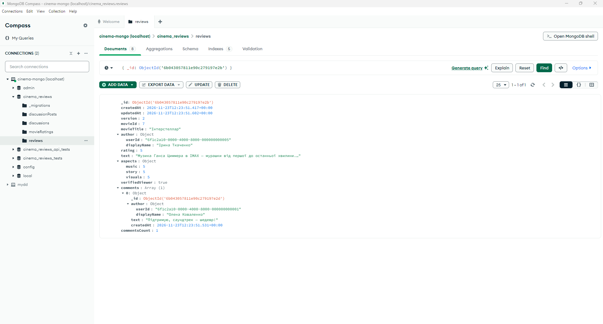
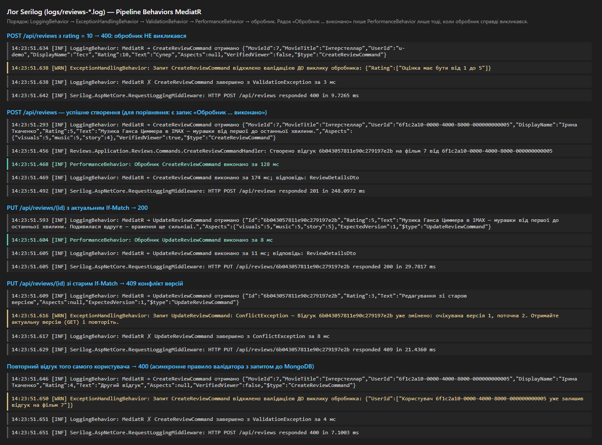
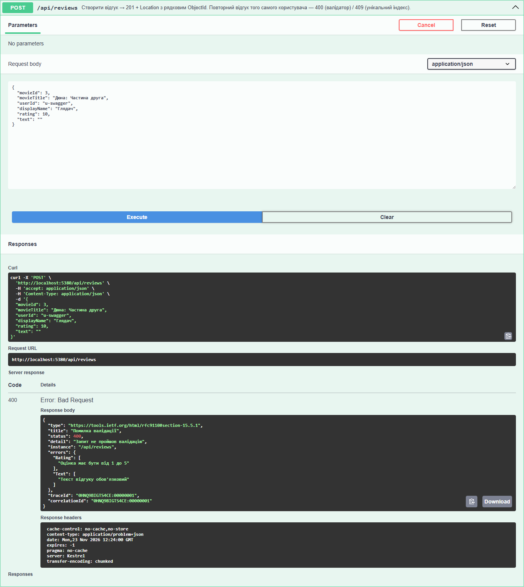
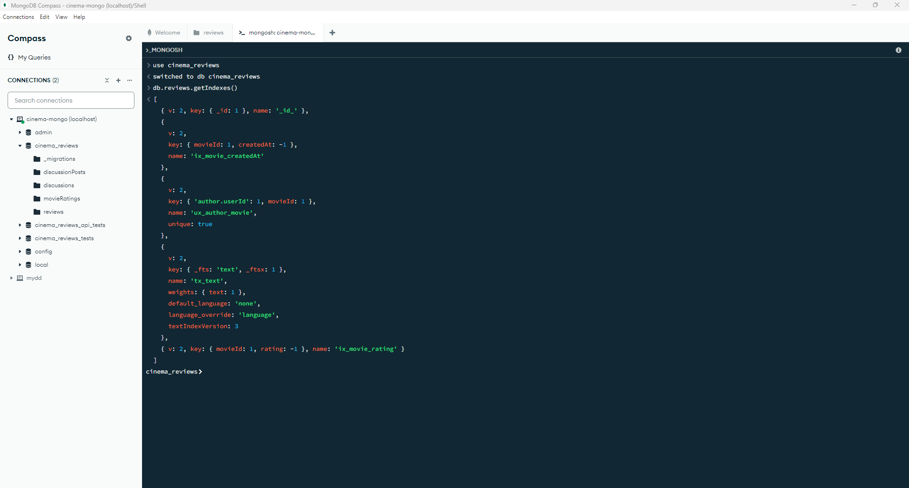

# Лаб. 04 — Clean Architecture, CQRS (MediatR) і MongoDB

> **Лаб. 05:** сервіс перенесено в `Services/Reviews/` і запускається разом з платформою через `Platform.AppHost` (див. [README в корені](../../README.md)). Команди й шляхи нижче (окрема папка, `verify.cmd`) описують самостійний запуск з Лаб. 04, гілка `lab-04`.

Мікросервіс **відгуків і обговорень** кінотеатру на базі **Проєкту №3 з Лаб. 01** (MongoDB `cinema_reviews`: колекції `reviews` з вкладеними коментарями і `discussions`). Побудований за Clean Architecture: чотири шари, а залежності спрямовані лише всередину.

## 1. Схема шарів

```
                ┌──────────────────────────────────────────────┐
                │ Reviews.WebApi (Presentation)                │  контролери → ISender, ProblemDetails,
                │                                              │  Swagger, Serilog, health check
                └───────────────┬──────────────────┬───────────┘
                                │                  │ (лише реєстрація DI у Program.cs)
                                ▼                  ▼
┌───────────────────────────────────────┐   ┌──────────────────────────────────────────┐
│ Reviews.Application (Use Cases)       │◄──│ Reviews.Infrastructure (MongoDB)         │
│ команди/запити MediatR, валідатори,   │   │ MongoDbContext, BsonClassMap, репозиторії│
│ Pipeline Behaviors, DTO, AutoMapper,  │   │ ReviewQueries (read-моделі), індекси,    │
│ інтерфейси IReviewQueries             │   │ сідінг, MongoHealthCheck                 │
└───────────────────┬───────────────────┘   └──────────────────┬───────────────────────┘
                    │                                          │
                    ▼                                          ▼
                ┌──────────────────────────────────────────────┐
                │ Reviews.Domain (Core)                        │  Review, Comment, Discussion,
                │ без посилань на інші проєкти                 │  Author, Rating, ReviewAspects,
                │ (з пакетів — лише MongoDB.Bson для ObjectId) │  DomainException, IReviewRepository
                └──────────────────────────────────────────────┘
```

| Проєкт | Посилання | Пакети |
|---|---|---|
| `Reviews.Domain` | — | MongoDB.Bson (лише тип ObjectId) |
| `Reviews.Application` | Domain | MediatR, FluentValidation (+ DependencyInjectionExtensions), AutoMapper |
| `Reviews.Infrastructure` | Application, Domain | MongoDB.Driver, MongoDB.Bson, Options.ConfigurationExtensions, HealthChecks |
| `Reviews.WebApi` | Application, Infrastructure | Swashbuckle.AspNetCore, Serilog.AspNetCore |
| `Reviews.Tests` | усі | xUnit, Moq, Mvc.Testing |

Правило залежностей перевіряють тести `ArchitectureTests`. Вони дивляться на зібрані збірки й перевіряють три речі: Domain не посилається на інші проєкти й на MongoDB.Driver; Application не знає про Infrastructure; жоден контролер чи обробник не тримає `IMongoCollection`, `IMongoDatabase` або `MongoDbContext`.

## 2. Запуск

Потрібні **.NET 9 SDK** і **MongoDB**. Підійде контейнер `cinema-mongo` з Лаб. 01 (`docker start cinema-mongo`) або будь-який MongoDB 6+.

```bash
cd Lab04-ReviewsService
dotnet run --project src/Reviews.WebApi
```

* Swagger: http://localhost:5380/swagger
* Health check: http://localhost:5380/health
* Приклади запитів: `src/Reviews.WebApi/Reviews.WebApi.http`

На старті два фонові сервіси готують базу:
1. `IndexCreationService` створює індекси (`Indexes.CreateManyAsync`). Повторний запуск безпечний.
2. `DataSeedingService` запускає всі `IDataSeeder`. Якщо колекція порожня, дані з `Seeding/Data/*.json` вставляються однією операцією `InsertManyAsync`. Якщо колекція вже наповнена, сідінг пропускається, тож дублів не буде.

Якщо в базі вже є дані з Лаб. 01 (скрипти `02_seed.js`), сервіс працює з ними. Імена й параметри індексів збігаються з `01_schema.js`, а невідомі поля гнучкої схеми (`spoiler`, `photos`, `poll`…) зберігаються під час оновлення документа.

### Конфігурація

Секція `MongoDb` в `appsettings.{Environment}.json`. Пул з'єднань і таймаути задаються параметрами рядка підключення:

```json
"MongoDb": {
  "ConnectionString": "mongodb://localhost:27017/?maxPoolSize=50&serverSelectionTimeoutMS=5000&connectTimeoutMS=5000",
  "DatabaseName": "cinema_reviews"
}
```

| Середовище | Файл | Сідінг |
|---|---|---|
| Development | `appsettings.Development.json` | так |
| Staging | `appsettings.Staging.json` | так |
| Production | `appsettings.Production.json` (рядок підключення — змінною `MongoDb__ConnectionString`) | ні |

Ключ Lucky Penny (MediatR 13 і AutoMapper 15, один на обидва) задається в `LuckyPenny:LicenseKey`, наприклад через `dotnet user-secrets`. Без ключа в лог пишеться попередження, для навчального проєкту цього досить.

## 3. Домен

| Тип | Що це | Правила |
|---|---|---|
| `BaseEntity` | `Id` (ObjectId), `CreatedAt`, `UpdatedAt`, `Version` | setter-и закриті; версію збільшує репозиторій |
| `Review` | відгук, корінь агрегату | оцінка 1–5, текст ≤ 5000, до 50 вкладених коментарів, `Edit`, `AddComment`, `RemoveComment` |
| `Comment` | вкладений документ у масиві `comments` | власний `_id`, текст ≤ 1000 |
| `Discussion` | тема обговорення | `Close` / `Reopen`, закриту тему не можна змінювати, до 10 тегів |
| `Author` (VO) | `userId` + `displayName` | незмінний, порівнюється за значенням |
| `Rating` (VO) | оцінка | `new Rating(10)` → `DomainException` без звернення до БД |
| `ReviewAspects` (VO) | оцінки аспектів `{ story: 5, acting: 4 }` | ключі латиницею, значення 1–5 |

У домені немає жодного BSON-атрибута. Мапінг налаштований у `Infrastructure/Persistence/MongoMappings.cs` через `BsonClassMap`:
* поля названі в camelCase, як у документах з Лаб. 01;
* приватне поле `_comments` зберігається як масив `comments`;
* `Author` створюється через конструктор (`MapCreator`);
* `Rating` записується як число, а `ReviewAspects` — як вкладений документ (власні серіалізатори);
* статус теми записується як рядок `"open"` / `"closed"`;
* null-поля не записуються.



## 4. CQRS і MediatR

| Команди (запис, через `IReviewRepository` / `IDiscussionRepository`) | Запити (читання, через `IReviewQueries` / `IDiscussionQueries`) |
|---|---|
| `CreateReviewCommand`, `UpdateReviewCommand`, `DeleteReviewCommand` | `GetReviewByIdQuery`, `GetReviewsListQuery` (фільтри, `$text`, сортування, skip/limit) |
| `AddCommentCommand`, `RemoveCommentCommand` | `GetReviewsFeedQuery` (курсорна пагінація `after = nextCursor`) |
| `RenameMovieCommand` (updateMany денормалізованої назви) | `GetMovieRatingQuery` (aggregation pipeline `$match → $group`) |
| `CreateDiscussionCommand`, `CloseDiscussionCommand`, `ReopenDiscussionCommand` | `GetDiscussionByIdQuery`, `GetDiscussionsListQuery` |

Маркерні інтерфейси `ICommand`, `ICommand<T>`, `IQuery<T>` лежать у `Application/Common/Messaging`. Читання працює з окремими плоскими read-моделями тієї самої колекції. Список вибирає з БД лише потрібні поля (без масиву `comments`) і одразу перетворюється на DTO.

### Pipeline Behaviors

Порядок задається в `Application/DependencyInjection.cs` через `AddOpenBehavior`:

```
LoggingBehavior → ExceptionHandlingBehavior → ValidationBehavior → PerformanceBehavior → обробник
```

* **LoggingBehavior** — що надійшло (`MediatR → …`) і чим завершилось (`←` або `✗`).
* **ExceptionHandlingBehavior** — логує виняток один раз на рівні MediatR: очікувані на рівні Warning, решту на рівні Error.
* **ValidationBehavior** — запускає всі валідатори FluentValidation, збирає помилки разом і кидає `ValidationException`. Обробник у цьому випадку не викликається.
* **PerformanceBehavior** — вимірює час обробника. Якщо обробник повільніший за `Performance:SlowRequestMs`, пише попередження. Запис «Обробник … виконано» з'являється лише тоді, коли обробник справді працював.

Валідатори є для всіх команд і критичних запитів. Вони перевіряють коректність ObjectId і дозволені поля сортування. Є також **асинхронне правило з запитом до MongoDB**: користувач ще не залишав відгук на цей фільм.

Демонстрація за логами: для `rating = 10` обробник не виконувався, а для успішного запиту виконувався. Повний фрагмент — у `docs/pipeline-log.log`.



## 5. API і статуси

| Метод | Шлях | Відповіді |
|---|---|---|
| GET | `/api/reviews?movieId=&userId=&minRating=&maxRating=&verifiedOnly=&search=&sortBy=&page=&pageSize=` | 200, 400 |
| GET | `/api/reviews/feed?movieId=&after=&limit=` | 200, 400 |
| GET | `/api/reviews/{id}` (заголовок `ETag` = версія) | 200, 400, 404 |
| POST | `/api/reviews` | 201 + `Location` з рядковим ObjectId, 400, 409 |
| PUT | `/api/reviews/{id}` + `If-Match: "версія"` (або поле `version`) | 200, 400, 404, 409 |
| DELETE | `/api/reviews/{id}` (+ необов'язковий `If-Match`) | 204, 404, 409 |
| POST / DELETE | `/api/reviews/{id}/comments`, `/api/reviews/{id}/comments/{commentId}` | 201 / 204, 400, 404 |
| GET | `/api/movies/{movieId}/rating` | 200, 404 |
| PUT | `/api/movies/{movieId}/title` | 200, 400 |
| GET / POST | `/api/discussions`, `/api/discussions/{id}`, `/{id}/close`, `/{id}/reopen` | 200 / 201, 400, 404, 409 |

AutoMapper:
* профіль `Application/Common/Mapping/MappingProfile.cs` мапить сутності в DTO: `ObjectId → string`, Value Objects, вкладений масив коментарів;
* профіль `WebApi/Contracts/RequestMappingProfile.cs` мапить HTTP-тіла в команди: id береться з маршруту, версія — з `If-Match`.

### Обробка помилок

`GlobalExceptionHandler` (`IExceptionHandler` + `AddProblemDetails`) повертає `application/problem+json` з `traceId` і `correlationId`:

| Виняток | Статус |
|---|---|
| `NotFoundException` | 404 |
| `ValidationException` (FluentValidation) | 400, `ValidationProblemDetails` з помилками по полях |
| `DomainException` | 400 |
| `ConflictException` (у т. ч. конфлікт версій) | 409 |
| `MongoWriteException` з `DuplicateKey` | 409 (інші помилки запису — 400) |
| `MongoConnectionException`, тайм-аут вибору сервера | 503 |

Оптимістична конкурентність влаштована так. Репозиторій виконує `ReplaceOne` з фільтром `{ _id, version: очікувана }`. Якщо документ уже змінили (`MatchedCount = 0`), кидається `ConflictException`, і клієнт отримує 409.



## 6. Індекси

| Колекція | Індекс | Під який запит |
|---|---|---|
| reviews | `ix_movie_createdAt` `{ movieId: 1, createdAt: -1 }` | відгуки фільму, нові зверху |
| reviews | `ux_author_movie` `{ author.userId: 1, movieId: 1 }`, unique | один відгук від користувача на фільм; «мої відгуки» |
| reviews | `tx_text` `{ text: "text" }`, `default_language: none` | повнотекстовий пошук `search=` |
| reviews | `ix_movie_rating` `{ movieId: 1, rating: -1 }` | найкращі/найгірші відгуки фільму |
| discussions | `ix_movie_activity` `{ movieId: 1, lastActivityAt: -1 }` | теми фільму, найактивніші зверху |
| discussions | `ix_tags` `{ tags: 1 }` | фільтр за тегом (multikey) |



## 7. Тести

```bash
# тести з MongoDB потребують змінної REVIEWS_TEST_MONGO; без неї виконуються лише unit-тести
set REVIEWS_TEST_MONGO=mongodb://localhost:27017
dotnet test
```

Інтеграційні тести працюють з окремими базами `cinema_reviews_tests` і `cinema_reviews_api_tests`, які створюються з нуля. `verify.cmd` робить усе разом: стартує контейнер, збирає рішення й запускає тести, результат пише у `verify.log`. Останній прогін: **50 з 50 пройдено**.

| Перевірка з розділу «перед здачею» | Тест |
|---|---|
| Reviews.Domain не має посилань на інші проєкти | `ArchitectureTests.Domain_references_no_other_project_and_no_mongodb_driver` |
| Жоден контролер чи обробник не звертається до IMongoCollection | `ArchitectureTests.No_controller_or_handler_uses_IMongoCollection_directly` |
| `Review` з `Rating = 10` → DomainException без БД | `DomainTests.Review_with_rating_10_throws_DomainException_without_database` |
| Команда з `Rating = 10` → 400 до обробника | `ApplicationTests.Pipeline_through_mediator_rejects_rating_10_before_handler_and_logs_it`, `ApiTests.Rating_10_returns_400_with_errors_before_handler` |
| Документ без витоку полів .NET, camelCase, вкладені author і comments | `MongoTests.Document_has_lab01_structure_camelCase_nested_author_and_comments_without_dotnet_internals` |
| Індекси створюються, повторне створення безпечне | `MongoTests.Indexes_are_created_and_recreation_is_safe` |
| Повторний запуск не дублює seed-дані | `MongoTests.Seeding_is_idempotent` |
| Повторний відгук того самого користувача → 400/409, не 500 | `ApiTests.Second_review_of_same_user_is_rejected_not_500`, `MongoTests.Unique_index_rejects_second_review_of_same_user_on_same_movie` |
| Конфлікт версій → 409 | `ApiTests.Update_with_stale_if_match_returns_409_and_fresh_one_200`, `MongoTests.Concurrent_update_with_old_version_is_conflict` |
| POST → 201 з рядковим ObjectId | `ApiTests.Post_returns_201_with_string_objectid_in_location_and_etag` |

## 8. Структура

```
Lab04-ReviewsService/
├── src/
│   ├── Reviews.Domain/          Common (BaseEntity, ValueObject), Entities, ValueObjects, Enums, Exceptions, Interfaces
│   ├── Reviews.Application/     Common (Behaviors, Exceptions, Interfaces, Mapping, Messaging, Models, Validation),
│   │                            Reviews / Discussions / Movies (Commands, Queries)
│   ├── Reviews.Infrastructure/  Persistence (MongoDbContext, MongoMappings, Serialization, Repositories, ReadModels, Queries),
│   │                            Seeding (IndexCreationService, IDataSeeder, Data/*.json), Health
│   └── Reviews.WebApi/          Controllers, Contracts, Infrastructure (GlobalExceptionHandler, LogContextMiddleware), Program.cs
├── tests/Reviews.Tests/         Unit, Integration, Api
└── docs/                        знімки екрана, фрагмент логу, контрольні питання
```
